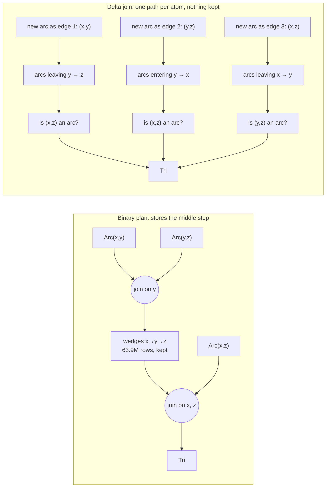
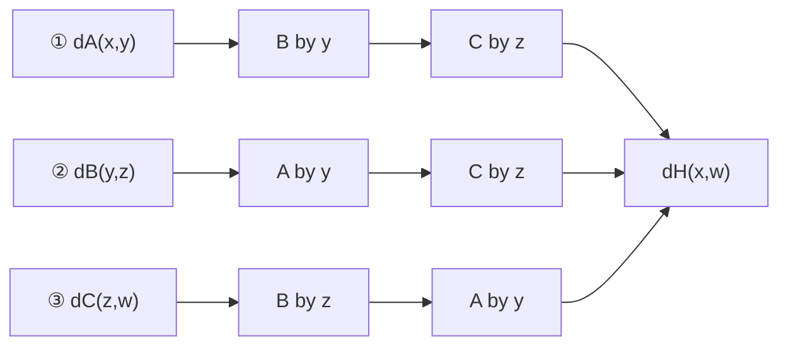
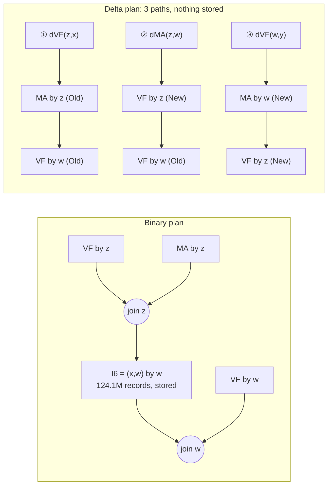
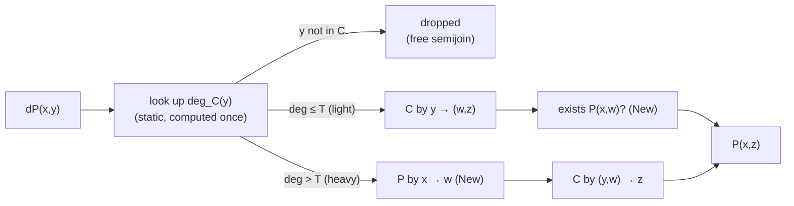
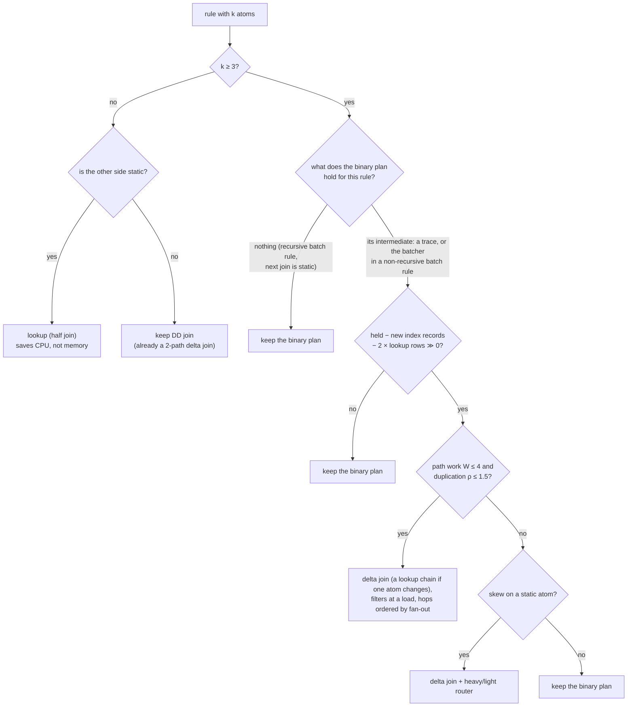

# Delta joins and half joins: how they work, and where they help FlowLog

Lab notes, November 2026. These are experiments on hand-patched FlowLog output, not a compiler feature.
Every number comes from a run in `results/`. Every run's output was checked: against the reference outputs, or, for the workloads added in §10 and §11, against the binary plan's output sizes.

**How to read this.** Part 1 explains the idea and the results in plain terms; it takes about fifteen minutes, and its first paragraph is the one-minute version. Part 2 is the lab notebook: every measurement, the code and the caveats. The [README](README.md) explains how to rerun any of it. Section numbers such as §5.1 point into Part 2.

# Part 1. The short version

**In one paragraph.** A binary join plan stores each rule's middle step: for the triangle rule, every two-step walk in the graph. A delta join stores no middle step. For every change, it looks the other atoms up in indexes instead. In FlowLog this pays off where a large middle step really is stored and the lookups stay cheap:
- non-recursive rules in batch mode (triangles: −50% time, −77% memory);
- recursive rules whose middle step is joined next with another recursive atom (CSPA: −15% memory; a Doop points-to rule: −9% time, −30% memory);
- rules with 3 or more atoms in incremental mode (incremental CSPA: −12% memory, −12% commit time).

It loses where nothing was stored, where it needs large new indexes, or where a lookup fans out (up to 7× slower). Over 20 cases, a simple rule for choosing gets −10% time and −15% memory, within about a point of the best possible picks: use one only if it stores fewer records and its lookups are cheap. Materialize's rule (use one only if it needs no new index) gets −7% and −11%, and makes 4 cases worse. On 9 new cases, 7 of them from 6 more programs, with its picks written down before the runs, the simple rule got −5% time and −3% memory, against −6% and −4% for the best picks. Its one miss saved under 1% of the program's records and cost 10% more time. A margin added afterwards, a saving of at least 5% of what the program stores, skips it. On CTADL's taint analyses, the rule with that margin, applied to each family of near-identical rules together, picks the best plans: −1% time, −7% memory ([CTADL.md](CTADL.md)).

## The problem: a join of three atoms stores its middle step

Take the triangle rule:

```
Tri(x,y,z) :- Arc(x,y), Arc(y,z), Arc(x,z).
```

FlowLog compiles it into two binary joins, as any Differential Dataflow (DD) program would:

1. Join the first two atoms into *wedges*: all two-step walks x → y → z.
2. Join the wedges with the third atom, keeping those that close into a triangle.

Each binary join keeps an index of both of its inputs, so that it stays correct when inputs change. DD calls such an index an *arrangement*.
So the wedges, the rule's middle step, are held in memory in full.
On the G40K graph that is 63.9M wedges, built from 1.6M arcs: the middle step is 40 times the input.

## The idea: look up instead of storing

A **delta join** never stores the middle step.
When arcs are added, it asks one question per atom and answers it with lookups into indexes of `Arc`. Each question is called a *path*:



- Each wedge lives only for a moment: it is built, checked and dropped.
- What stays in memory are the three indexes of `Arc` that the lookups read, and the binary plan builds those anyway.
- When all the data arrives at once, as in batch mode, one path is enough. A delta join with a single path is a **lookup chain**.

**The trade-off in one line:** a delta join swaps a stored middle step for lookup work, and it may need indexes that the binary plan did not have.
It wins when the middle step is big, the indexes already exist, and the lookups do little more work than the binary join did.

Two details make it correct:

- **Each new result is counted once.** If two arcs of one triangle arrive in the same update, two paths could each find that triangle. So the atoms get a fixed order. A path sees the atoms *before* it including the current update ("New"), and the atoms *after* it only as they were before the update ("Old"). Exactly one path then finds each new triangle (§1.4).
- **A lookup waits for complete data.** A row from time t is answered only once the index it reads has received everything up to t. Until then, the row waits inside the lookup (§1.5).

## Half join vs delta join

- A **half join** is the building block: one lookup step.
  - Changes on one side look up an index of the other side. Changes on the other side trigger nothing.
  - DD has it as `half_join` in the separate `differential-dogs3` crate. FlowLog's `feat/lookup-operator` branch has it as `flowlog_lookup`.
- A **delta join** is a plan built from half joins: one chain of them per atom, as in the picture.
- DD's ordinary `join` is two half joins glued together, each side looking up the other. So for two atoms it already is a delta join. Delta joins only matter for rules with **three or more atoms**.

## How Materialize uses them

- **Two inputs:** a binary join, which already is a 2-path delta join.
- **Three or more inputs:** a delta join only if **every index it needs already exists**. Then it adds no memory and removes every middle step. Otherwise it uses a binary join. An "eager" setting also allows a delta join that needs no more new indexes than the binary plan.
- **No CPU estimate.** "No loss" in Materialize means no extra memory, not no extra work.
- **At a bulk load, only one path can find anything.** Every input arrives at the same time, so every Old version is still empty, and only the path with no Old lookups can match. Materialize drops the other paths' rows before they do any lookups (its *snapshot filter*). For a one-shot `SELECT` it keeps only that path, which is a lookup chain (§1.6).

## What FlowLog already gets for free

- **Two-atom joins** already are delta joins.
- **In batch mode, joining a recursive relation with a static one stores nothing for the recursive side.**
  - FlowLog closes its static inputs, and DD then frees the recursive side's index (§2).
  - A lookup still saves CPU here. DD's join sorts and indexes every new batch of the recursive side; a lookup does not. TC: −10% time (§4).
- So in batch mode a delta join can only save memory in two places:
  - in a **non-recursive** rule with 3 or more atoms. Its whole middle step waits in DD's sort buffer (the *batcher*) until the inputs are complete, as with the triangles;
  - in a **recursive** rule whose middle step is joined next with another recursive atom (CSPA rule 6, GALEN rules 3, 4 and 6).
- **In incremental mode** inputs never close. So every middle step is stored, and every rule with 3 or more atoms is a candidate. This is Materialize's setting.

## What I measured

I hand-patched FlowLog's generated Rust so that chosen rules use lookups, lookup chains or delta joins. Each plan is compared with FlowLog's plan today, which uses binary joins everywhere.
- All numbers cover the whole program: wall time and peak memory (peak RSS), with 8 workers.
- Each is the median of 3 or more runs, except the two GALEN losses, which are single runs (§6.1).
- "Incremental update" rows load 99.9% of the data, then add the last 0.1% in one transaction, and include that commit.

**Wins**

| Workload (rule shape) | Plan | Time | Memory | Why |
|---|---|---|---|---|
| Triangles G40K (3 atoms, not recursive) | lookup chain | −50% | −77% | It stops storing 63.9M wedges. |
| Triangles BerkStan | lookup chain | −27% | −22% | It stops storing 222.5M wedges. |
| Triangles roadNet | lookup chain | −38% | −1% | Wedges are only 3× the arcs here (40× on G40K). Stored records fall 35%, but the 8.3M rows waiting inside lookups take that memory back. |
| Triangles G40K, incremental update | delta join + load filter | −35% | −66% | Same reason. Commits are also 48% faster. |
| CSPA rule 6, httpd (3 atoms, recursive) | delta join, reusing an index | −4% | −15% | It drops a 124M-record middle step. MA is symmetric, so the index it needs already exists. |
| CSPA rules 4 and 6, httpd, incremental update | delta joins | −6% | −12% | 28% fewer stored records. Commits are 12% faster. |
| GALEN rule 4 (3 atoms, recursive) | delta join + heavy/light router | +1% | −26% | It drops a 28.4M middle step. The router avoids a bad lookup order. |
| Doop, AssignCast rule (5 atoms, recursive; §11) | delta join, cheapest lookup order | −9% | −30% | It drops an 11.7M middle step. Its lookup order reads a shared index of VarPointsTo, so a 37.2M-record index that only this rule read goes too. |
| TC (2 atoms, recursive ⋈ static) | lookup | −10% | +1% | It skips sorting and indexing each new batch. |
| Polonius (2-atom joins) | lookups | −3% | −1% | The same reason, with a smaller effect. |
| Reach, CC, SSSP, Bipartite, CSDA (2 atoms, recursive ⋈ static; §11) | lookups | −2% to −16% | ~0% | The same reason. Memory moved −1% to +1%, and +4% on Reach, within its run-to-run spread. |

**Trade-offs**

| Workload | Plan | Time | Memory | Why |
|---|---|---|---|---|
| Triangles roadNet, incremental update | delta join + load filter | −19% | +17% | Commits are 34% faster and stored records fall 32%. But as in batch mode, the lookups hold 8.3M rows at the load, a copy of all 5.5M arcs among them. |
| GALEN rule 6 | delta join | +9% | −9% | It drops a 19.8M middle step, but its paths do 2.3 times that much work. |
| CSPA rule 6, postgresql | delta join, reusing an index | −2% | −3% | Stored records fall 18%, but rows held in lookups (13M) and run-to-run noise hide most of it. |
| CSPA rule 6, linux | delta join, reusing an index | +2% | +3% | The middle step (14.9M) is about what the lookups hold (12.1M). |
| Andersen, load rule | delta join | +5% | −5% | It drops a 1.3M middle step but adds a new 2.65M index. Memory fell anyway, for a reason I did not track down. |
| Doop, AssignCast rule, written lookup order | delta join | +3% | −11% | It drops the same middle step, but its last lookup still needs the 37.2M-record index. |

**Losses**

| Workload | Plan | Time | Memory | Why |
|---|---|---|---|---|
| GALEN rule 4, wrong lookup order | delta join | 7.2× | −28% | The first lookup fans out: 2.9 billion probes to replace a 28.4M middle step. |
| GALEN rule 3 | delta join | +49% | −2% | Its paths do 65 times the work of the 5.9M middle step. |
| Same generation (SG) | lookup chain | +74% | +41% | Nothing was stored, because the middle step's next join is with a static atom. The paths also carry 2.3× duplicates. |
| SG, incremental update | delta join | +118% | +68% | It needs a new index as big as the middle step, and carries 2.3× duplicates. |
| Dyck | lookup chains | +5% | +20% | Nothing was stored to save. |
| Dyck, incremental update | delta join + load filters | +11% | +16% | It drops only 0.6M records, under 1% of the program's. The rest is unexplained overhead. |
| Andersen, store rule | delta join | +16% | +22% | It needs a new 10.5M index to drop a 0.9M middle step. |
| Doop, InstanceFieldPointsTo rule (4 atoms, recursive; §11) | delta join | +10% | 0% | It saves 0.5% of the program's records. Two of its paths each push all 37.2M VarPointsTo rows through lookups. |

Two more Polonius rules came out neutral, with memory unchanged: a lookup (+1% time) and a 4-atom lookup chain (−1%) (§11).

## Why some cases win and others lose

1. **Only a stored middle step can be saved.** Triangles store tens of millions of wedges, so they win big. In batch mode, SG's and Dyck's middle steps were already freed, so a chain can only add overhead.
2. **New indexes can cancel the saving.** Each new index is a full copy of a relation under another key, so count records, not indexes.
   - Andersen's store rule trades a 0.9M-record middle step for a 10.5M-record index.
   - CSPA rule 6 with a new 88.9M index saves 7% memory instead of 15%. Noticing that MA is symmetric lets it reuse the index that exists.
   - A plan can also let an index go. In Doop's AssignCast rule, the cheaper lookup order reads a shared index of VarPointsTo, so a 37.2M-record index that only this rule read goes too: −30% memory instead of −11% (§11).
3. **A path's lookup order can explode the work.** Each path joins in a fixed order. If its first lookup fans out, it does huge work for a small result.
   - Estimate each path's work from fan-out counts, compare it with the middle step it replaces, and order each path's lookups to keep it small.
   - When a static relation is skewed, route each row by its key's degree in that relation (§7). That took GALEN rule 4 from 7.2× to +1% time.
4. **At the first load, only one path can produce anything.** The other paths still run unless their rows are dropped first.
   - Dropping them (Materialize's snapshot filter) took incremental triangles from +17% time to −35% on G40K, and from +26% to −19% on roadNet.
   - Inside FlowLog's loops, recursive relations are also empty at that moment. So paths that look one up can be dropped as well: a *loop filter* (§10.4).
5. **Rows waiting inside lookups cost memory that DD does not report.**
   - Rows wait while the index they read is incomplete, and queue when a lookup has more work than its budget per step (its *fuel*). They sit uncompressed in plain vectors.
   - That is why memory falls less than stored records (CSPA httpd: −22% records, −15% memory), and why roadNet's triangles save no memory in batch mode and use more in incremental mode.

One effect remains unexplained. Dyck's incremental delta join does no wasted work, yet costs +11% time and +16% memory. The counters account for about a tenth of the extra memory (§10.4).
So a delta join has fixed costs, and a small saving does not pay for them. Doop's InstanceFieldPointsTo rule points the same way: it saves 0.5% of the program's records and costs 10% more time (§11).

## A rule for FlowLog

I wrote candidate rules for choosing a plan as code. Each one is scored on all 20 cases by what its choices measured (§10).

| Choose a lookup or delta join when… | Time | Memory | Cases >5% worse | Worst slowdown |
|---|---|---|---|---|
| never (FlowLog today) | 0% | 0% | 0 | 1.00× |
| Materialize: 3+ atoms and no new index | −7% | −11% | 4 | 1.74× |
| Materialize, eager: 3+ atoms and no more new indexes than the binary plan | +1% | −9% | 9 | 2.18× |
| it stores fewer records (middle step > new indexes) | +1% | −15% | 5 | 7.17× |
| it stores fewer records and its paths are cheap (path work ≤ 4× the middle step, path output ≤ 1.5× the binary join's) | −10% | −13% | 3 | 1.11× |
| **the same, plus a heavy/light router when every lookup order is costly** | **−10%** | **−15%** | **3** | **1.11×** |
| the best plan per case, picked in hindsight | −11% | −16% | – | 1.09× |

Time and memory are geometric means over the 20 cases, including the cases a rule leaves alone. Every delta join in the table uses the load filters.

- **The router rule comes within about one point of the best possible picks.**
  - Part 2 calls the last three rules H3, H4 and H5.
  - H6 also charges for the rows held inside lookups, as the checklist below does. It scores the same, and skips one case that does not pay (CSPA linux).
- **Three cases still come out more than 5% worse, under both cheap-path rules.**
  - GALEN rule 6 and roadNet's incremental triangles trade time against memory, and are still the best plan for their case.
  - Dyck's incremental update is a real miss, caused by the fixed overhead above.
- **Materialize's rule saves memory on average but makes 4 cases worse.** It counts indexes, not records or work. It also cannot see that FlowLog's batch mode already frees some middle steps (SG, Dyck).

As a checklist for a rule with k atoms:

1. **k = 2:** keep DD's join. In batch mode, if the other side is static, use a lookup instead: it saves CPU.
2. **k ≥ 3: is a middle step stored?**
   - In incremental mode, always.
   - In batch mode, only in a non-recursive rule, or when the middle step's next join is with a recursive atom.
   - If none is stored, keep the binary plan.
3. **Does it save records?**
   - The middle step, plus any index the plan lets go, must clearly outweigh the new indexes plus the rows the lookups will hold.
   - Reuse existing indexes where possible, including through symmetry. A lookup order that reads a shared index can let a rule's own index go (§11).
   - Require a saving of at least about 5% of the records the program stores. This margin was set after the test on new programs below.
4. **Is it cheap?**
   - Path work at most about 4× the middle step, and path output at most 1.5× the binary join's.
   - Order each path's lookups by fan-out. If a skewed static relation makes every order expensive, route rows by its degree.
5. **At the first load,** drop the rows of paths that cannot find anything.

**On new programs.** I then froze the rules and their thresholds, took 9 more cases, 7 from 6 more programs and 2 from Polonius, and wrote down each rule's picks before timing anything (§11). Each cell is time / memory:

| Choose a lookup or delta join when… | 20 tuning cases | 9 new cases | All 29 | Cases >5% worse, of 29 | Worst slowdown |
|---|---|---|---|---|---|
| never (FlowLog today) | 0% / 0% | 0% / 0% | 0% / 0% | 0 | 1.00× |
| Materialize: 3+ atoms and no new index | −7% / −11% | 0% / 0% | −5% / −8% | 4 | 1.74× |
| the router rule (bold above) | −10% / −15% | −5% / −3% | −9% / −11% | 4 | 1.11× |
| the checklist above, with its 5% margin (set afterwards) | −11% / −15% | −6% / −3% | −9% / −12% | 2 | 1.09× |
| the best plan per case, picked in hindsight | −11% / −16% | −6% / −4% | −9% / −12% | – | 1.09× |

- **On the new cases, among the rules fixed in advance, only the cheap-path rules came within about one point of the best picks on both time and memory.**
  - They found the biggest new win, Doop's AssignCast rule (−9% time, −30% memory), because ordering each path's lookups by cost let a 37M-record index go.
  - The new cases gain less than the first 20: six of the nine are 2-atom lookups, which save only CPU.
- **They had one miss:** Doop's InstanceFieldPointsTo rule, +10% time for 0.5% of the program's records. Like Dyck's incremental update, it saves too little to pay for a delta join's fixed costs.
- **The margin skips exactly these two misses,** and any margin from 1% to 11% does the same. With it, the rule matches the best picks over all 29 cases, and its two cases worse are the trade-offs above. But I chose it after seeing the new results, so it still needs a fresh test. Part 2 calls it H7.
- **Materialize's rule changed one plan** on the new cases, a neutral one.

**On CTADL's analyses** ([CTADL.md](CTADL.md)), one family of eight near-identical rules holds 6–20% of what each program stores, split across the rules. Tested rule by rule, the margin switches almost none of them. Tested on the family's total, it picks the best plans on all four programs: −1% time and −7% memory, none worse. This version, too, was set after the runs.

## What I would do next in FlowLog

Easiest and safest first:

1. **Land the improved lookup operator.**
   - With the `feat/lookup-operator` lookup, CSPA's delta join used 11% more CPU than the binary plan. Seeking each key once, instead of once per row, turned that into 5% less (§4).
   - Capping its work per step (fuel) keeps memory in check: without it, TC's peak memory grew 19–38%.
   - A review against the half joins Materialize uses, from `differential-dogs3`, found no wrong answers, and found FlowLog's lookup the fastest with integer keys. It also caught a slowdown that §4's merging of duplicate rows had added: string keys were rebuilt in every comparison of a sort. Building each key once made Doop's delta plans 4% faster (§12).
   - It is draft PR [#533][pr-a], with tests: the runtime's 565 tests pass, 27 of them for the lookup.
   - It need not stay an operator of its own. With a three-line change to `differential-dogs3`, its `half_join2` runs FlowLog's lookups and passes their tests ([#535][pr-c]), but it is slower with integer keys. Differential 0.26 has since shipped that change, and FlowLog's operator is still faster with integer keys, so keep it (§12.7).
2. **Lookups for 2-atom joins against static relations, in batch mode.** A local swap that needs no new index. It was faster in 7 of the 8 cases measured, by 2% to 16% (TC, Polonius, Reach, CC, SSSP, Bipartite, CSDA), with memory unchanged. The eighth, a second Polonius rule, was +1%, within noise.
3. **Lookup chains for non-recursive rules with 3 or more atoms, in batch mode,** when the middle step is large next to the inputs. These were the biggest wins: triangles −50% time and −77% memory on G40K.
4. **Delta joins for rules with 3 or more atoms, behind the checklist,** opt-in at first. They come with load filters, a lookup order per path, heavy/light routers and index reuse. §13 sketches the rewrite.
5. **A memory probe in FlowLog's profiler:** stored records per index, plus rows held inside lookups. It found the free half join of §2 and showed which index each record saving here came from, so it is the natural tool for picking candidate rules.

## Common questions

- **Is the delta join DD's default?** No. DD's `join` is binary. Half joins, and delta joins built from them, are in the separate `differential-dogs3` crate, and you wire them up yourself.
- **Is a half join the same as a delta join?** No. A half join is one operator, a single lookup step. A delta join is a plan made of one chain of half joins per atom.
- **How does Materialize choose between delta and binary joins?** Binary for two inputs. For three or more, delta only if no new index is needed; with the eager setting, no more new indexes than the binary plan. It never estimates CPU.
- **What was "CSPA rule 5", and is its −15% for the whole program?** It is rule 6 in source order, `VA(x,y) :- VF(z,x), MA(z,w), VF(w,y)`; scripts still call it `r5`. Yes: −15% is the whole program's peak memory, from changing that one rule (§5.1).
- **Does saving memory cost time?** Not necessarily.
  - With index reuse, CSPA rule 6 also got 4% faster.
  - It costs time when the paths do more work than the binary join (GALEN rule 6: +9%), and a lot when a lookup order is bad (GALEN rule 4: 7.2×).
- **Can FlowLog use Materialize's rule as it is?** It helps on average (−7% time, −11% memory), but makes 4 of 20 cases worse, up to 1.74× slower. On the 9 new cases it changed one plan and saved nothing.
- **How can Materialize's choice be "no loss"?** It is no loss in memory: when every index already exists, the delta join adds no state and removes the middle steps. It can still cost CPU, and Materialize accepts that.
- **Did the rule hold up on programs it had not seen?** Mostly. On 9 new cases, with the picks written down before the runs, it got −5% time and −3% memory against −6% and −4% for the best picks, with one miss (+10% time). A margin set afterwards skips that miss, but needs its own test (§11).
- **Is FlowLog's lookup operator ready to build on?** Mostly. Its answers are correct, with new tests on several workers. With integer keys it is faster than dogs3's half joins, because it seeks each key once for all of that key's rows. The merging step this study added had made it slow with string keys, and [#533][pr-a] fixes that. One interface change remains for when the compiler targets it: borrow each row's key instead of building a new one, as Materialize does (§12.3, [#534][pr-b]).
- **Does FlowLog need a lookup operator of its own?** No. dogs3's `half_join2` computes the same answers: FlowLog's versions, compaction holds, landing times and fuel map onto its arguments. Only a `Monoid` bound it never uses keeps presence weights out, and relaxing it takes three lines. Through a thin adapter, [#535][pr-c], it passes the lookup's tests. It is 26–33% faster with string keys, but 9–23% slower with integer keys even with a second patch that groups rows by key. Differential 0.26 has since shipped the bound but not the grouping, so keep FlowLog's operator for now (§12.7).

## Limits of this study

- These are hand-patched programs, not compiler output. A real planner may pick better or worse lookup orders.
- There are 1–3 datasets per program, run on a shared 64-core machine. Time differences under about 3% are noise, and so are peak-memory differences under about 5%.
- The thresholds were tuned on the first 20 cases. They held up on 9 new ones, but the 5% margin was set after those, so it is untested, as is its per-family version for CTADL.
- More in §14.

---

# Part 2. Lab notebook

Sections: 1 how a delta join works · 2 what FlowLog gets for free · 3 lab setup · 4 a faster lookup · 5 wins in batch mode · 6 where delta joins hurt · 7 a heavy/light router · 8 incremental mode · 9 when a delta join pays off · 10 choosing a plan, on 20 cases · 11 a held-out test, on 9 more cases · 12 a review of the lookup operator · 13 ideas for FlowLog · 14 caveats · 15 artifacts.

## Terms

| Term | Meaning |
|---|---|
| Arrangement (index) | DD's indexed, shareable copy of a collection, keyed by some columns. Its stored part is the *trace*. |
| Batcher | The buffer where an arrangement sorts incoming updates before they enter its trace. |
| Stored records | Records in all traces and batchers at their peak, from DD's logging (`patches/probe.py`). |
| Peak RSS | The most memory the process used at any moment ("memory" in Part 1). |
| Intermediate | A rule's middle step, such as the triangle rule's wedges. The *held* intermediate is what the binary plan keeps of it. |
| Half join, lookup | Rows from one input probe an arrangement of another (`flowlog_lookup`, `flowlog_lookup_exists`). |
| Path ①, ②, ③ | One atom's chain of lookups in a delta join, numbered by the atom's position. |
| Lookup chain | A delta join with a single path. |
| Old, New | Whether a path sees a probed atom as it was before the current time t (< t), or including t (≤ t) (§1.4). |
| Static, recursive | An input relation that is complete before the loop starts, and a relation computed inside the loop (a *loop variable*). |
| Batch, incremental | One run over all the data, and a long-running program that takes `begin`/`commit` transactions. A `-split` dataset preloads 99.9% of the changing input and commits the rest. |
| Load | The first time, when everything arrives at once. |
| Snapshot filter, loop filter | Dropping, at the load, the rows of paths that cannot find anything (§10.4). |
| W (path work) | The partial tuples the paths build (after every lookup but the last), plus the input-relation rows that drive them, divided by the binary plan's intermediates (§10.2). |
| ρ (duplication) | Path output rows per binary-plan output row. Paths do not remove duplicates between lookups. |
| Lookup rows | Rows waiting inside lookups: *stashed* until the probed arrangement is complete for their time, or queued behind the fuel limit (§10.5). |
| Fuel | A cap on the work a lookup does per activation before it yields: about 1M rows plus their matches. |
| Heavy/light router | Picks each row's lookup order from its key's degree in a static atom (§7). |
| H0–H6 | The plan-choosing policies compared in §10. |
| w=8 | 8 worker threads. |

## 1. How a delta join works, in detail

### 1.1 What a binary plan costs

Take `H(x,w) :- A(x,y), B(y,z), C(z,w).`
FlowLog, like any Differential Dataflow (DD) program, plans this as two binary joins:

- `I = A ⋈y B`, re-keyed by `z`
- `H = I ⋈z C`

To keep `H` correct as inputs change, each join keeps an index (an *arrangement*) of both of its inputs.
So the intermediate `I` is stored in full for the whole run.
`I` can be much larger than `A`, `B`, `C` or `H`.

### 1.2 The delta rule: one path per atom

If each atom changes by `dA`, `dB`, `dC`, the change to the join is

```
d(A ⋈ B ⋈ C) = dA ⋈ B ⋈ C   +   A' ⋈ dB ⋈ C   +   A' ⋈ B' ⋈ dC        (A' = A + dA, B' = B + dB)
```

Each term is a *path*.
A path starts from one atom's changes and looks up the other atoms in their indexes:



- Rows flow down a path and are gone. Nothing between the hops is stored.
- The only state is the per-atom indexes, which other rules often need anyway (FlowLog shares them).
- Each path can use its own join order: path ③ goes C → B → A.
- The price: a path may need an index the binary plan did not have, such as `B by z` above.

### 1.3 The half join is the building block

- A **half join** reacts to changes on its left input only. Each change probes a stored index of the right input. Changes to the right input do nothing.
- DD's ordinary `join` is two half joins glued together. It arranges both inputs, and changes on each side probe the other side's arrangement. So it is already a 2-path delta join, and a 2-atom rule gains nothing from a delta join.
- A delta join is one chain of half joins per atom. DD's `differential-dogs3` crate calls the operator `half_join`, Materialize uses it in `delta_join.rs`, and FlowLog's `feat/lookup-operator` branch calls it `flowlog_lookup` (plus `flowlog_lookup_exists` for existence checks).

### 1.4 The tie-break: Old and New

If `A` and `B` change at the same time `t`, path ① would see `dB` and path ② would see `dA`, so `dA·dB` would be counted twice.
The fix is to put the atoms in a fixed order:

| Atom compared with the path's own atom | It sees updates at | Name |
|---|---|---|
| Comes **before** it | times ≤ t | `Version::New` |
| Comes **after** it | times < t | `Version::Old` |

This is exactly the `A' ... B ... C` pattern in the formula above, so each combination of changes is counted exactly once.
It also works for self-joins (TC-style `P ⋈ P`), because each occurrence of a relation is its own atom in the order.

Worked example for `H(x,z) :- A(x,y), B(y,z)`, with `a(1,2)` and `b(2,3)` both arriving at time `t`:

- Path ① (dA): `a(1,2)` looks up B at y=2 with Old (< t). `b(2,3)` is at `t`, so there is no match.
- Path ② (dB): `b(2,3)` looks up A at y=2 with New (≤ t). It finds `a(1,2)`, so `H(1,3)` is produced once. ✓

Materialize uses the mirror image (`source < lookup` gives `≤`, otherwise `<`; `delta_join.rs` lines 187 and 366–400).
Both choices are correct.

### 1.5 What it takes inside a streaming engine

① **Time travels with the row.**
A path row keeps its change's original time `t`, and every Old/New test at every hop uses that `t`.
`flowlog_path` copies the time into the data, and `flowlog_land` places the result at the time it lands.
With FlowLog's totally ordered clocks this is always the row's own time.

② **Wait for the index.**
A row at `t` can only be answered once the index can no longer receive an update the row should see.
That is the case when the index's frontier has passed `t`. Until then, rows wait in a stash.

③ **Hold compaction.**
The index must keep enough history to tell `< t` from `≤ t` for every waiting row.
So the lookup holds the index's logical compaction at the earliest pending time.

④ **Fuel.**
One row can match many values. The lookup caps its work per activation and reschedules itself, as DD's join does.
Without fuel, TC's peak RSS grew 19–38% (§4).

⑤ **Sorted, grouped probing.**
Ready rows are sorted by key and consolidated.
Each key is sought once, its values are read into a buffer, and all of that key's rows are answered from the buffer (§4).

⑥ **Static atoms first (FlowLog batch mode).**
EDB facts are all present at the start of the loop, and recursive facts only arrive in later iterations.
With static atoms first in the order, a static atom's own path finds nothing older and can be dropped. Only recursive atoms need paths.

### 1.6 Why Materialize uses it everywhere, and what it costs there

- Materialize keeps many shared arrangements (indexes) anyway. A delta join over indexes that already exist adds no memory. In Frank's words: *"Materialize considers this plan only if all the necessary arrangement already exist, in which case the additional cost of the join is zero"* ("Joins in Materialize", 2020).
- The price is many indexes ("a quadratic number of arrangements") and a fixed join order inside each path.
- Classic index-based Datalog evaluates semi-naive rules the same way: start from the delta, probe indexes of the other atoms, and store nothing in between. Frank's datatoad states it directly: *"restrict ourselves to only interacting with base atoms through indexes"* (2025-11-21).
- A binary DD plan is the outlier, because it stores its intermediates.
- **Only one path runs at the snapshot.** When a dataflow starts, every input arrives at one time, the as-of. Under the tie-break, every path except relation 0's then probes an earlier relation with `<`, finds nothing, and would only waste its lookups. So Materialize drops those paths' updates at the as-of before any lookup (`build_update_stream_trace`, `delta_join.rs` lines 756–758 and 800–801). In FlowLog's mirrored convention the surviving path is the last one, which is all New. §10.4 measures this *snapshot filter*.
- **One-shot queries keep that one path and nothing else.** A `SELECT` runs at a single time. For such dataflows, `LirRelationExpr::finalize_dataflow` keeps only the first path (`plan.path_plans.truncate(1)`). It also feeds that path's source as a raw collection when the source's arrangement existed only for it (`compute-types/src/plan.rs` lines 715–760 at `c52ddaf6a7`, PR #37297, July 2026).
  - The result is a lookup chain: the plan that wins on FlowLog's non-recursive triangle rule (§10.3).
  - It skips recursive (`WITH MUTUALLY RECURSIVE`) joins.
  - It runs after planning: `join_implementation.rs` picks delta or binary without knowing the query is one-shot.

---

## 2. FlowLog today: half joins you already get for free in batch mode

In batch mode, FlowLog closes its static inputs (`inputs.close_static()`) before the fixpoint finishes.
DD's join then drops its handle on the other side's trace (`differential-dataflow 0.25.1`, `operators/join.rs` ~350–372, "Drop if `input2` is empty").
The arranging operator only keeps a `Weak` reference (`arrange/writer.rs:25`), so that trace is freed.

The result: in batch mode, **a recursive ⋈ static join stores nothing for the recursive side**.
It still pays CPU to arrange each recursive delta (§4), but it keeps no memory for it.

The DD logging probe (`FLOWLOG_PROBE=1`) confirms this:

| Arrangement | Batch | Incremental (inputs never close) |
|---|---|---|
| TC: `tc` keyed by z (joined with Arc) | 0 | 24.7M records |
| CSPA: `ValueAlias` keyed by c0 (joined with Dereference) | 0 | 234.2M |
| CSPA: rule 4 intermediate (joined with Dereference) | 0 | 141.0M |
| CSPA: rule 6 intermediate (joined with ValueFlow, which is recursive) | 124.1M | 120.6M |

So in batch mode, inside a recursive rule, a delta join can only save memory on intermediates that are joined with a *recursive* atom:

| Program | Rule | Stored intermediate | Next join is with | Records |
|---|---|---|---|---|
| CSPA | R4 `MA(x,w) :- Deref(y,x), VA(y,z), Deref(z,w)` | π[x,z](Deref ⋈ VA) | Deref (static) | 0 (freed) |
| CSPA | R6 `VA(x,y) :- VF(z,x), MA(z,w), VF(w,y)` | π[x,w](VF ⋈ MA) | VF (recursive) | 124.1M |
| GALEN | R3 `P(x,z) :- P(y,w), U(w,r,z), Q(x,r,y)` | π[y,r,z](P ⋈ U) | Q (recursive) | 5.9M |
| GALEN | R4 `P(x,z) :- C(y,w,z), P(x,w), P(x,y)` | C ⋈ P | P (recursive) | 28.4M |
| GALEN | R6 `Q(x,e,o) :- Q(x,y,z), R(y,u,e), Q(z,u,o)` | π[x,z,u,e](Q ⋈ R) | Q (recursive) | 19.8M |

**Non-recursive rules are the exception** (found later, §10.6 lesson 1).
- All of the rule's rows share one time, so the arrange operator holds its whole intermediate in its batcher until the inputs close.
- DD's logging reports these rows as batcher records, not trace records, so the tables above miss them.
- The triangle rule holds 63.9M wedges this way on G40K. A lookup chain streams them through its lookups instead of storing them.

---

## 3. Lab setup

- **Code.** FlowLog `main` (49d9999), plus the team's `feat/lookup-operator` commit (c24f89e, from [#450](https://github.com/flowlog-rs/flowlog/pull/450)), plus my changes to `flowlog-runtime/src/operators/lookup.rs` (§4, §10.5, §12.3). Together they are draft PR [#533][pr-a], which this study's branch builds on.
- **Method.**
  - Compile `.dl` to Rust with FlowLog.
  - Rewrite the generated `main.rs` with one patch per experiment (`patches/`).
  - Build against this branch's runtime and run. `scripts/build.py` does all three for any build in `builds.txt` (see the README).
- **Correctness.** Every run's relation sizes are compared with reference outputs. All variants matched, including both epochs in incremental mode.
- **Metrics.**
  - All metrics cover the whole program: one process, all workers, all rules and inputs. A variant changes only the rules it names, so any difference comes from those rules.
  - Wall time and peak RSS (the most memory the process used at any moment) from `/usr/bin/time`.
  - Median of 3 interleaved reps, except sweeps marked "1 rep" and CSPA batch at w=8 (8 reps, because its base peak RSS varies by about 1 GB between runs; §5.1).
  - Stored records from DD's logging (`patches/probe.py`): the most records held by all arrangements at once, summed over workers, with a per-arrangement breakdown.
  - CPU attribution with `perf`.
  - MB means 2^20 bytes.
- **Machine.** 64-core EPYC 7763 with 503 GB RAM, shared with other users (load 1–5). Treat differences under ~3% as noise.
- **Data.**
  - TC: G5K-0.001 (Tc = 24.7M).
  - CSPA: httpd (VF 1.37M, MA 88.9M, VA 234.2M).
  - GALEN: P 7.56M, Q 16.6M.
  - The workloads added for the policy study (triangles, SG, Dyck, Andersen, Polonius, CSPA postgresql and linux) are listed in §10.1.
- **Rule numbers** count rules in source order from 1 (`example/program_analysis/cspa.dl`, `example/knowledge_reasoning/galen.dl`). Scripts and file names use an older label, `r5`, for CSPA rule 6 (`patches/cspa_r5_delta.py`, builds `cspa_inc_r5` and `cspa_inc_r45`).

---

## 4. CPU: making the half join fast

The `feat/lookup-operator` lookup did one seek and one value walk per row.
On DD's multi-batch cursor (`CursorList`), that is expensive: `minimize_vals` and `OffsetList::index` dominate.
CSPA (batch, w=8) profiles:

| Variant | perf samples | of which cursor navigation |
|---|---|---|
| Base (DD joins) | 110k | 15.1k |
| Delta join, per-row lookup | 122k (+11%) | 26.1k |
| Delta join, grouped lookup | 104k (−5%) | 13.6k |

**Fix:** group ready rows by key, seek once per key, and copy that key's values and updates into a buffer.
All the key's rows are answered from that buffer, the way DD's join loads each key once (`EditList::load`, `join.rs:545`).

**Other operator changes:**
- fuel: about 1M probed rows plus output records per activation, then the operator reschedules itself (DD's join spends 2M output records per activation, split over its two sides, `join.rs:334`)
- sorting and consolidating ready rows
- a compaction hold that also covers queued work
- dropping the trace only when nothing is pending

**Using it for recursive ⋈ static (TC, batch):** `Tc(x,y) :- Tc(x,z), Arc(z,y)`, with the join swapped for a lookup into Arc's index.
The whole change (`patches/tc_lookup.diff`) removes the `tc`-by-z arrangement and the `flowlog_join`, and puts this in their place (variable names shortened):

```rust
let t_10737080078935328747 = flowlog_land(
    flowlog_lookup(
        flowlog_path(recursive_rel_1_tc.clone(), "Path: dtc"),
        in_t_8895333882570235874_arr.clone(),          // Arc by z, already built for the join
        "Lookup: dtc * arc",
        Version::New,
        |&(_x, z): &(i16, i16)| (z,),                  // key of the row
        |&(x, _z): &(i16, i16), rv: &(i16,)| Some((x, rv.0)),
    ),
    "Land",
);
```

| Variant | w=1 | w=8 | w=32 |
|---|---|---|---|
| Base (DD join) | 28.64 s / 825 MB | 4.33 s / 1121 MB | 1.44 s / 1520 MB |
| Lookup, per row | 29.65 s / 860 MB | 4.37 s / 1117 MB | 1.46 s / 1612 MB |
| **Lookup, grouped** | **25.72 s (−10%)** / 856 MB | **3.88 s (−10%)** / 1129 MB | **1.37 s (−5%)** / 1523 MB |

**Re-measured on the operator as committed** (`results/group_recheck.log`, median of 3 interleaved reps).
Both lookup rows run one binary: `FLOWLOG_LOOKUP_GROUP=0` makes it seek and load the key's values again for every row, into the same buffers, so the two rows differ only in grouping.

| Variant | w=1 | w=8 | w=32 |
|---|---|---|---|
| Base (DD join) | 28.61 s / 827 MB | 4.30 s / 1130 MB | 1.50 s / 1519 MB |
| Lookup, per row | 28.72 s / 864 MB | 4.27 s / 1082 MB | 1.62 s / 1624 MB |
| **Lookup, grouped** | **25.00 s (−13%)** / 851 MB | **3.80 s (−12%)** / 1103 MB | 1.41 s (−6%) / 1596 MB |

The w=32 runs spread by up to 0.27 s (base: 1.39–1.66 s), so that column is within noise.
CSPA with the symmetric delta join (§5.1, w=8, 3 reps) splits the same way: base 27.56 s / 8,940 MB, per row 30.17 s (+9%) / 7,307 MB, grouped 26.55 s (−4%) / 7,506 MB.

- **Why it is faster:** DD's join must arrange each new batch of Tc, which means a batcher sort plus a batch build. `VecMerger` (the batcher) is the top symbol in every profile. The lookup skips all of that.
- **Why memory does not change:** the trace was already dropped (§2).
- **Fuel ablation** (TC, before grouping):

  | | w=1 | w=8 | w=32 |
  |---|---|---|---|
  | With fuel | 858 MB | 1105 MB | 1603 MB |
  | Without fuel | 1183 MB (+38%) | 1393 MB (+26%) | 1911 MB (+19%) |

  Times were equal, so fuel is a memory feature.
  Consolidating ready rows saves a little more: 894 → 858 MB at w=1 and 1670 → 1603 MB at w=32 (no change at w=8). §12.6 re-checks this on the operator as committed: merging saves time, not memory.

---

## 5. Where delta joins help (batch mode)

### 5.1 CSPA rule 6: −22% stored records, −15% RSS (whole program)



- Path ③ needs MA keyed by its *second* column, which would be a new 88.9M-record index.
- MA is symmetric in CSPA: `MA(a,b)` holds exactly when `MA(b,a)` does, and both are derived in the same round (by induction over the rules). So path ③ can read `MA(z,w)` as `MA(w,z)` from the existing index. This stands in for "the index already exists", which is Materialize's rule.

| Variant | Stored records (peak) | w=8 (median of 8) | w=32 (median of 3) |
|---|---|---|---|
| Base | 554.1M | 27.59 s / 8870 MB | 9.11 s / 9862 MB |
| Delta, new MA index | 518.9M (−6%) | 28.46 s (+3%) / 8224 MB (−7%) | 9.78 s (+7%) / 9470 MB (−4%) |
| **Delta, symmetric reuse** | **430.0M (−22%)** | **26.45 s (−4%) / 7506 MB (−15%)** | 8.99 s (−1%) / 8796 MB (−11%) |

The accounting is exact: 554.1M − 124.1M (I6) = 430.0M, and 430.0M + 88.9M (new index) = 518.9M.

Where the whole program's records sit at their peak (`results/probe_cspa_base_p.txt`, `probe_cspa_delta_sym_p.txt`):

| Arrangement | Base | Delta, symmetric reuse |
|---|---|---|
| VA distinct | 246.3M | 246.3M |
| I6, rule 6's own intermediate | 124.1M | 0 |
| MA distinct | 88.9M | 88.9M |
| MA by c0 (read by rules 2 and 6) | 88.9M | 88.9M |
| All others (VF, Dereference, Assign) | 5.9M | 5.9M |
| **Total** | **554.1M** | **430.0M (−22%)** |

So rule 6's own intermediate goes from 124.1M stored records to 0. The indexes it reads (VF by c0, MA by c0) are the same in both plans.
RSS falls less than records (−15% vs −22%) because RSS also counts memory outside the stored records, such as batcher buffers (peak 62.8M records in the base vs 70.3M with the delta join) and merges in progress.

Base peak RSS at w=8 varies by about 1 GB between runs (8,242–9,229 MB over 8 runs), most likely with merge timing.
Paired with the base run next to it, symmetric reuse saves 8.5% to 18.0% (median 14.8%), and all 8 of its runs peaked below every base run.

### 5.2 GALEN rules 4 and 6: −26% to −32% RSS

| Variant | Stored records | w=8 | w=32 |
|---|---|---|---|
| Base | 158.0M | 10.77 s / 3972 MB | 4.58 s / 5048 MB |
| d6: rule 6 | 138.6M (−12%) | 11.78 s (+9%) / 3617 MB (−9%) | 4.98 s (+9%) / 4776 MB (−5%) |
| **d4s: rule 4 with router (§7)** | 130.2M (−18%) | **10.92 s (+1%) / 2955 MB (−26%)** | **4.52 s (−1%) / 3813 MB (−24%)** |
| **d4s6: both** | 110.8M (−30%) | 11.73 s (+9%) / 2710 MB (−32%) | 4.86 s (+6%) / 3571 MB (−29%) |

- Rule 6 removes I3 (19.8M) but its paths probe more than the binary plan did, hence +9% time.
- Rule 4 only works with the router in §7.

---

## 6. Where delta joins hurt

### 6.1 A fixed join order can explode

A binary plan joins whole relations, while a path joins one atom's changes against indexes in a fixed order.
If the first hop fans out a lot, the path does huge work even when the result is small.
The estimator (`scripts/galen_wco.py`) counts probes for each order of the costly path:

| Rule, path | Order 1 | Order 2 | Per-row best | Intermediate it replaces |
|---|---|---|---|---|
| R4, dP(x,y) | C by y: **2,929M** | P by x: 394M | 42.4M | 28.4M |
| R3, dQ(x,r,y) | P by y: 375M | U by r: **19,743M** | 90.7M | 5.9M |
| R6, dQ(z,u,o) | R by u: 25.8M | Q by z: 963M | 12.1M | 19.8M |

What the runs showed (1 rep each for d3/d4):

- **d4** (C first): 77.17 s vs 10.77 s at w=8 (**7.2×**), and 54.91 s vs 4.58 s at w=32 (12×), even though RSS fell to 2851 MB.
- **d3**: 16.04 s (+49%) at w=8. RSS barely moved: 3906 vs 3972 MB at w=8, and it got worse at w=32 (5537 vs 5048 MB).
- **d6** used the 25.8M order: +9% time.

**Rule of thumb:** compare a path's probe count with the size of the intermediate it removes.
R6 (26M probes vs 20M stored) is a good trade. R3 (375M vs 5.9M) is a bad one.

### 6.2 New indexes can eat the savings

Each new index is a full copy of a relation under a different key.

- CSPA R6 without symmetry: the new 88.9M index cancels 72% of the 124.1M saved.
- GALEN R3 needs `U by (w,r)` and saves only 5.9M, so its RSS did not improve.

### 6.3 Path rows are temporary but bursty

Path rows are not arranged: they are not compressed, and each carries a second timestamp.

- Without fuel, a whole iteration of matches piles up (+19–38% in TC, §4).
- Even with fuel, incremental CSPA's delta plan used about 18% more RSS in the first 16 s, and less afterwards (§8).

---

## 7. Rule 4 in depth: a heavy/light router

The costly path is `dP(x,y)` in `P(x,z) :- C(y,w,z), P(x,w), P(x,y)`. It must find `(w,z)` with `C(y,w,z)` and `P(x,w)`.

- **C first:** propose every `(w,z)` of C for this `y` (up to 35,744 per `y`), then check `P(x,w)`.
- **P first:** propose every `w` of P for this `x` (at most 162 per `x`), then look up `C(y,w)` to get `z`.

Neither order is best for every row.
But C is **static**, so its degree per `y` is known before the fixpoint starts.
I computed it once (`count_total` over C, then arranged), and each row looks up its degree and picks its order:



| Threshold T | Estimated probes | Heavy keys | Wall at w=8 (1 rep) |
|---|---|---|---|
| 0 (always P first, plus semijoin) | 114.2M | 17,382 | 11.23 s |
| 4 | 68.2M | 2,658 | 10.83 s |
| 16 | 48.3M | 769 | 10.83 s |
| **64 (used in d4s)** | **43.8M** | 261 | **10.83 s** |
| 256 | 74.0M | 85 | 11.63 s |
| 1024 | 146.9M | 28 | 13.03 s |
| 4096 | 223.1M | 5 | 14.24 s |
| ∞ (always C first = d4) | 2,929M | 0 | 77.17 s |
| P first, no router (d4p) | 394M | – | 14.04 s (3-rep median 13.85 s) |
| Best per row (lower bound) | 42.4M | – | – |

- One static degree table gets within 4% of the per-row optimum (43.8M vs 42.4M).
- The degree lookup also filters out rows whose `y` is not in C. That alone is worth 3.5× over plain P first (114M vs 394M).
- Wall time follows the estimated order closely. So a simple sum of fan-outs is a usable cost model.

---

## 8. Incremental mode: Materialize's home ground

In FlowLog's incremental mode (`.decl R(...) append`, then `begin` / `insert` / `commit` transactions), inputs never close.
So the free half join from §2 disappears, and every join keeps both sides:

| Probe builds, w=8, 1 run | Batch | Incremental |
|---|---|---|
| TC stored records (peak) | 44.3M | 68.7M (+55%) |
| TC peak RSS | 1138 MB | 1668 MB (+47%) |
| CSPA stored records (peak) | 554.1M | 926.8M (+67%) |

Some of this is inherent: to react to a new Arc fact, Tc must be indexed by its join key, and a delta join needs that same index.
What a delta join *can* remove are the intermediates of rules with 3 or more atoms: CSPA R4 (141.0M) and R6 (120.6M).

**R4 as a delta join.** Every atom can change, so every atom gets a path, and every index it reads already exists:

```
① dDeref(y,x) → VA by y (Old)   → Deref by z (Old)
② dVA(y,z)    → Deref by y (New) → Deref by z (Old)
③ dDeref(z,w) → VA by z (New, read as VA(z,y) because VA is symmetric) → Deref by y (New)
```

**Experiment.**
- Preload 99.9% of CSPA httpd. Every 1000th input row is held out: 362 Assign and 1,147 Dereference rows.
- Commit the held-out rows as one transaction, at w=8, median of 3.
- The update changes VF by +2,830, MA by +1,803,472 and VA by +4,577,702 facts. All variants agree at both epochs.

| Variant | Preload | Commit | Wall | Peak RSS | Stored records |
|---|---|---|---|---|---|
| Base | 36.26 s | 1.755 s | 38.31 s | 12,280 MB | 926.1M |
| R4 delta | 35.56 s (−2%) | 1.577 s (−10%) | 37.49 s (−2%) | 11,590 MB (−6%) | 785.2M (−15%) |
| R6 delta | 35.02 s (−3%) | 1.692 s (−4%) | 37.01 s (−3%) | 11,331 MB (−8%) | 806.9M (−13%) |
| **R4 + R6 delta** | **34.23 s (−6%)** | **1.542 s (−12%)** | **36.12 s (−6%)** | **10,854 MB (−12%)** | **666.1M (−28%)** |

- **Faster commits.** The base plan must merge each update into its 141M- and 121M-record intermediates. The delta paths only probe, which is most likely why commits are 10–12% faster.
- **Records vs RSS.** Stored records fell 28%, but peak RSS fell only 12%. A 100 ms RSS timeline (1 run each, `results/rss_timeline_*.tsv`) shows why:

  | | Base | R4 + R6 |
  |---|---|---|
  | Mean RSS, first 16 s | 4.06 GiB | 4.78 GiB (+18%, path rows in flight) |
  | Mean RSS, 24–34 s | 10.09 GiB | 9.26 GiB (−8%) |
  | Memory × time | 262 GiB·s | 240 GiB·s (−8%) |

  The peak comes from short spikes, most likely merges and batchers of the two largest arrangements (`VA` by c0 and VA's distinct, 480M records), which no variant touches.
- **Long-lived services.** For an incremental service that stays up, the stored-record drop (−28%) is the number that lasts.

---

## 9. When does a delta join pay off in FlowLog?



1. **Rules with 2 atoms: no delta join.** DD's join already is one. When the other side is static (batch mode), a lookup still saves CPU: TC −10%, Polonius −3% (§4, §10.3).
2. **Batch mode:**
   - Inside a recursive rule, only intermediates joined with a recursive atom are stored, so only those can be saved (CSPA R6, GALEN R3/R4/R6; not CSPA R4).
   - A non-recursive rule holds its whole intermediate in the batcher, so a lookup chain can save all of it (triangles: −77% RSS on G40K; §10.6).
3. **Incremental mode:** every intermediate is stored, so every rule with 3 or more atoms is a candidate. This is where Materialize lives.
4. **Count records, not indexes:** saving = held intermediate − new index records. Look for reuse, including symmetry. The saving must also be large next to the rest of the program (item 9).
5. **Count probes:**
   - Compare the sum of fan-outs along each path with the intermediate it replaces (W ≤ 4 worked), and choose each path's order by that sum.
   - Check duplication too (ρ ≤ 1.5 worked), because paths do not consolidate between hops.
6. **Skewed static atom:** route each row by the static degree (§7).
7. **Filter the snapshot:** at a bulk load every Old version is empty, so only the last path (all New) can produce anything. Drop the other paths' load rows before their first lookup, as Materialize does (§1.6, §10.4).
   - Inside a loop, also drop the load rows of every path that probes a loop variable. Loop variables are empty at the loop's first time.
8. **Charge rows held inside lookups:** at a load, one stashed copy of the driving relation of the path that runs, plus any fuel backlog. Count each held row as about 2 stored records (§10.5).
9. **Expect a fixed overhead.** Even with no wasted work (W = 1.0), Dyck's incremental delta join costs +11% time and +16% RSS. The intermediate it drops is 0.6M of the 73M records the program stores, and its batchers grow by more (§10.4). So the saving needs a margin, which these cases cannot calibrate (§11.4 sets one after the fact).

§10 turns these rules into policies H4–H6 and tests them against Materialize's rule on 20 cases. §11 tests them on 9 more.

---

## 10. Choosing a plan: seven policies on more workloads

Which rules should get a lookup, a lookup chain or a delta join?
I wrote seven candidate policies as code (`scripts/heuristics.py`), plus H0, the plan FlowLog builds today.
I measured every plan they could pick on 20 cases (8 programs on 11 datasets, 5 of them also split for incremental runs) and scored each policy by what its picks measured.
A policy sees only facts that a compiler could know, or get from a profile, before it chooses.

### 10.1 New workloads

All runs: w=8, median of 3 interleaved reps, whole-program wall time and peak RSS. Incremental triangles and Dyck pool every session a plan ran in (3–9 runs, §10.4).
Incremental runs load all but every 1000th row of the changing input (0.1%), then insert those rows in one commit (`scripts/split.py`, as in §8).

| Program | Rule changed | Mode | Data | Why it is interesting |
|---|---|---|---|---|
| Triangles | `Tri(x,y,z) :- Arc(x,y), Arc(y,z), Arc(x,z)` | batch | G40K (1.6M arcs), roadNet-CA (5.5M), web-BerkStan (7.6M) | Non-recursive; the intermediate (wedges) is far bigger than the input |
| Triangles | same | incremental | G40K-split, roadNet-split | Every atom changes; the delta join needs no new index |
| Same generation (SG) | `Sg(x,y) :- Arc(a,x), Sg(a,b), Arc(b,y)` | both | G5K (Sg 24.7M), G5K-split | One recursive atom between two static ones |
| Dyck | `Dyck(x,y) :- Zero(x,z), Dyck(z,w), Zero(w,y)`, and the same with One | both | kernel (Zero 2.0M, One 7.5M), kernel-split | Every index the paths need already exists |
| Andersen | load: `PT(y,w) :- Load(y,x), PT(x,z), PT(z,w)`; store: `PT(z,w) :- Store(y,x), PT(y,z), PT(x,w)` | batch | medium (PT 2.65M) | Two recursive atoms; a new index is needed |
| Polonius | `move_error(P,T) :- pmuoe(P,S), cfg_edge(S,T)`, and the recursive rule for pmuoe (`path_maybe_uninitialized_on_exit`) | batch | borrow (291M rows in each output) | 2-atom joins with very large outputs |
| CSPA rule 6 | §5.1 | batch | postgresql, linux | Fresh data for the earlier winner |

The earlier cases are included too: TC (§4), CSPA httpd (§5.1), GALEN rules 3, 4 and 6 (§5.2–§7), and incremental CSPA (§8).
- **Data:** all from FlowLog's benchmark set (`NemoYuu/flowlog_benchmark` on Hugging Face). roadNet-CA and web-BerkStan are SNAP graphs.
- **Correctness:** every plan's output sizes matched the binary plan's.
  - Batch: all 69 runs.
  - Incremental: at both times, and the two times sum to the batch result.
- **SG's split is degenerate.** Its update adds no Sg tuples, because Sg already holds every pair of nodes that have an incoming arc (4,973² = 24.7M). Its commit measures only derivation work.

### 10.2 The policies

| Policy | Replaces the binary plan when |
|---|---|
| H0 | never (FlowLog today) |
| H1 Materialize default | the rule has 3+ atoms and the delta join needs no new index |
| H1e Materialize eager | the rule has 3+ atoms and needs no more new indexes than the binary plan builds |
| H2 structural | in batch mode: a 2-atom join, or a rule with at most one changing atom (lookup or lookup chain); otherwise H1 |
| H3 size | the binary plan's held intermediate has more records than the new indexes (2-atom joins: always a lookup) |
| H4 size + CPU guards | H3, and path work W ≤ 4, and duplication ρ ≤ 1.5; each path's hops are ordered by estimated work (§6.1) |
| H5 | H4; otherwise a heavy/light router (§7), if there is one |
| H6 | H5, and also charge each row the plan's lookups hold (§10.5) as 2 records |

Every delta join a policy picks includes Materialize's snapshot filter (§10.4), whatever its hop order. Inside a loop it also includes the loop filter, which drops the load rows of paths that probe a loop variable. The unfiltered plans I built first appear in the results only as references.

The facts behind them:

- **Held intermediate:** what the binary plan keeps in memory for this rule.
  - The intermediate's trace, when its next join is with a changing atom. In incremental mode, that is always.
  - In a non-recursive batch rule, the whole intermediate. It waits in the arrange batcher (§10.6, lesson 1).
  - Zero in a recursive batch rule whose next join is static (the free half join of §2).
- **W (path work):** the partial tuples after every hop of every path but the last, plus the rows of input relations that drive paths, divided by the raw intermediate (the binary plan's intermediates before consolidation, summed).
  - Rows of loop variables that drive paths are left out, because the binary plan joins each of them too. SG's chain, driven by Sg, has W = 1.0; the triangle chain, driven by Arc, has W = 1.0 + |Arc| / |wedges|.
  - Load rows that the filters drop do not count.
  - It comes from degree statistics.
- **ρ (duplication):** path output rows per binary output row. The binary plan consolidates its intermediate; paths do not consolidate between hops.
- **Lookup rows:** the most rows held inside the plan's lookups at once (a new probe, §10.5). Only H6 reads them.

### 10.3 Results

Each plan relative to the binary plan: wall time, peak RSS and, for incremental runs, commit latency.
"Held" is the binary plan's held intermediate in records. "Lookup rows" is the plan's peak; n/m means not measured.

| Case | Binary plan | Plan | Time | RSS | Commit | Held | New index | Lookup rows | W | ρ |
|---|---|---|---|---|---|---|---|---|---|---|
| TC G5K (§4) | 4.33 s, 1,121 MB | lookup | −10% | +1% | | – | 0 | n/m | n/m | 1.00 |
| Polonius borrow | 87.2 s, 13,433 MB | lookups in both joins¹ | −3% | −1% | | – | 0 | n/m | n/m | 1.00 |
| Triangles G40K | 1.73 s, 2,261 MB | lookup chain | −50% | −77% | | 63.9M | 0 | 2.6M | 1.0 | 1.00 |
| Triangles roadNet | 1.18 s, 704 MB | lookup chain | −38% | −1% | | 17.5M | 0 | 8.3M | 1.3 | 1.00 |
| Triangles BerkStan | 8.70 s, 5,971 MB | lookup chain | −27% | −22% | | 222.5M | 0 | 69.7M | 1.0 | 1.00 |
| SG G5K | 8.15 s, 2,016 MB | lookup chain | +74% | +41% | | 0 | 0 | 76.0M | 1.0 | 2.34 |
| Dyck kernel | 1.27 s, 836 MB | lookup chains | +5% | +20% | | 0 | 0 | 0 | 1.0 | 1.00 |
| Andersen load | 1.83 s, 1,223 MB | delta | +5% | −5% | | 1.3M | 2.65M | n/m | n/m | 1.00 |
| Andersen store | 1.83 s, 1,223 MB | delta | +16% | +22% | | 0.9M | 10.5M | n/m | n/m | 1.00 |
| CSPA R6 httpd (§5.1) | 27.6 s, 8,870 MB | delta, MA symmetric | −4% | −15% | | 124.1M | 0 | 19.0M | 2.0 | 1.03 |
| | | delta, new MA index | +3% | −7% | | | 88.9M | 19.4M | 2.0 | 1.03 |
| CSPA R6 postgresql | 30.1 s, 8,618 MB | delta, MA symmetric | −2% | −3% | | 110.5M | 0 | 13.0M | 2.0 | 1.03 |
| | | delta, new MA index | +5% | −3% | | | 89.5M | 12.5M | 2.0 | 1.03 |
| CSPA R6 linux | 6.78 s, 2,443 MB | delta, MA symmetric | +2% | +3% | | 14.9M | 0 | 12.1M | 2.0 | 1.03 |
| | | delta, new MA index | +5% | +18% | | | 13.8M | 12.1M | 2.0 | 1.03 |
| GALEN R3 (§6.1) | 10.8 s, 3,972 MB | delta | +49% | −2% | | 5.9M | 0.10M | n/m | 64.6 | n/m |
| GALEN R4 (§6.1, §7) | 10.8 s, 3,972 MB | delta, C first | +617% | −28% | | 28.4M | 0.23M | n/m | 104.1 | n/m |
| | | delta, P first | +29% | −24% | | | 0.23M | n/m | 14.9 | n/m |
| | | delta + router | +1% | −26% | | | 0.69M | n/m | 2.5 | n/m |
| GALEN R6 (§5.2) | 10.8 s, 3,972 MB | delta | +9% | −9% | | 19.8M | 385 | n/m | 2.3 | n/m |
| Triangles G40K-split | 1.90 s, 2,792 MB, commit 10.1 ms | delta + snapshot filter | −35% | −66% | −48% | 63.9M | 0 | 4.2M | 1.0 | 1.00 |
| | | delta, no filter | +17% | −64% | −50% | | 0 | 7.5M | 2.1 | 1.00 |
| | | delta, Old first, no filter | −33% | −66% | −48% | | 0 | 5.0–5.7M | 1.1 | 1.00 |
| Triangles roadNet-split | 1.33 s, 1,093 MB, commit 8.2 ms | delta + snapshot filter | −19% | +17% | −34% | 17.5M | 0 | 8.3M | 1.3 | 1.00 |
| | | delta, no filter | +26% | +47% | −35% | | 0 | 14.9M | 2.9 | 1.00 |
| | | delta, Old first, no filter | −8% | +32% | −36% | | 0 | 7.6–8.3M | 1.9 | 1.00 |
| SG G5K-split | 7.53 s, 2,593 MB, commit 22.2 ms | delta³ | +118% | +68% | +95% | 24.7M | 24.7M | 68.7M | 1.0 | 2.34 |
| Dyck kernel-split | 1.61 s, 1,633 MB, commit 17.8 ms | delta + loop filter | +11% | +16% | +6% | 0.6M | 0 | 1.6K | 1.0 | 1.00 |
| | | delta + snapshot filter | +15% | +14% | +5% | | 0 | 1.6K | 16.6 | 1.00 |
| | | delta, no filter | +20% | +13% | +5% | | 0 | 1.6K | 32.3 | 1.00 |
| CSPA httpd-split (§8) | 38.3 s, 12,280 MB, commit 1.76 s | delta in R4 and R6, symmetric²,³ | −6% | −12% | −12% | 261.6M | 0 | n/m | 2.0 | 1.03 |

¹ A lookup in only one of the two joins: −2% time, −1% or −0% RSS.
² Delta join in R4 only: −2%, −6%, −10% commit. In R6 only: −3%, −8%, −4% commit. W and ρ are known for R6 only.
³ Measured without the filters. At the load they would drop only the rows of the paths driven by static atoms: SG's paths ① and ③ (25K arcs each), and CSPA R4's (Dereference, 1.15M rows each, in a 38 s run). All three of CSPA R6's atoms are loop variables, which hold no rows at the load.

Which plan each policy picks ("–" is the binary plan; "Best" is the measured plan with the lowest time × RSS; an incremental "delta" includes the filters):

| Case | H1 | H1e | H2 | H3 | H4 | H5 | H6 | Best |
|---|---|---|---|---|---|---|---|---|
| TC G5K | – | – | lookup | lookup | lookup | lookup | lookup | lookup |
| Polonius borrow | – | – | lookups | lookups | lookups | lookups | lookups | lookups |
| Triangles, 3 datasets | chain | chain | chain | chain | chain | chain | chain | chain |
| SG G5K | chain | chain | chain | – | – | – | – | – |
| Dyck kernel | chain | chain | chain | – | – | – | – | – |
| Andersen load | – | delta | – | – | – | – | – | delta |
| Andersen store | – | delta | – | – | – | – | – | – |
| CSPA R6 httpd, postgresql | symmetric | symmetric | symmetric | symmetric | symmetric | symmetric | symmetric | symmetric |
| CSPA R6 linux | symmetric | symmetric | symmetric | symmetric | symmetric | symmetric | – | – |
| GALEN R3 | – | delta | – | delta | – | – | – | – |
| GALEN R4 | – | P first | – | C first | – | router | router | router |
| GALEN R6 | – | delta | – | delta | delta | delta | delta | delta |
| Triangles G40K-split | delta | delta | delta | delta | delta | delta | delta | delta |
| Triangles roadNet-split | delta | delta | delta | delta | delta | delta | delta | delta |
| SG G5K-split | – | delta | – | – | – | – | – | – |
| Dyck kernel-split | delta | delta | delta | delta | delta | delta | delta | – |
| CSPA httpd-split | symmetric | symmetric | symmetric | symmetric | symmetric | symmetric | symmetric | symmetric |

Scorecard: geometric means over the 20 cases. "Worse" means more than 5% worse in time or in RSS.

| Policy | Plans changed | Time | RSS | Time × RSS | Cases worse | Worst time |
|---|---|---|---|---|---|---|
| H0 binary (FlowLog today) | 0 | 0% | 0% | 0% | 0 | 1.00× |
| H1 Materialize default | 12 | −7% | −11% | −17% | 4: SG, Dyck, triangles roadNet-split, Dyck-split | 1.74× |
| H1e Materialize eager | 18 | +1% | −9% | −9% | 9 | 2.18× |
| H2 structural | 14 | −8% | −11% | −18% | 4, the same as H1 | 1.74× |
| H3 size | 15 | +1% | −15% | −14% | 5: GALEN ×3, triangles roadNet-split, Dyck-split | 7.17× |
| H4 size + CPU guards | 13 | −10% | −13% | −22% | 3: GALEN R6, triangles roadNet-split, Dyck-split | 1.11× |
| H5 = H4 + router | 14 | −10% | −15% | −24% | 3, the same | 1.11× |
| H6 = H5 + lookup-row charge | 13 | −10% | −15% | −24% | 3, the same | 1.11× |
| Best measured plan per case | – | −11% | −16% | −25% | – | 1.09× |

What the scorecard says:

- **Materialize's rule is a memory rule, not a cost rule.** "No new index" (H1) saves memory on average (−11% RSS) and, with its snapshot filter, some time (−7%). But it made 4 of 20 cases worse, up to 1.74× the time:
  - chains where the binary plan held nothing (SG, Dyck);
  - triangles roadNet-split, which trades +17% RSS for −19% time and −34% commit latency;
  - Dyck incremental, which saves a 0.6M-record intermediate and costs +11% time and +16% RSS.

  Without the snapshot filter, the same rule scored −2% time and −10% RSS, with 5 cases worse. The eager variant (H1e) also takes Andersen store, whose one new index is 12× the intermediate it saves.
- **Counting records instead of indexes (H3) finds the memory (−15% RSS) but not the time** (+1%; GALEN R4 at 7.17×).
- **Adding the CPU guards (H4) keeps both**: −10% time and −13% RSS, with no plan worse than 1.11× time.
  - The router (H5) adds GALEN R4.
  - The lookup-row charge (H6) drops CSPA linux.
  - H6 then comes within one point of the best measured plan per case on all three means.
- **Three flags are left.**
  - GALEN R6 (+9% time, −9% RSS) is also the best plan by time × RSS.
  - Triangles roadNet-split (+17% RSS, −19% time, −34% commit latency) is also the best plan by time × RSS.
  - Dyck-split is a miss. With the loop filter its paths do the binary plan's work (W = 1.0), so the guards pass it, yet it costs +11% time and +16% RSS. Its saving, 0.6M records, is under 1% of what the program stores, and no counter explains the extra RSS (§10.4). Before the loop filter, the W guard rejected it, but for the wrong reason.
- **Caution: H4–H6 are scored in-sample.**
  - The guards (W ≤ 4, ρ ≤ 1.5) were set after seeing SG, Dyck and GALEN, and H6's weight after attributing CSPA's memory (§10.5).
  - Out-of-sample checks:
    - CSPA postgresql and linux, where H4 picked the symmetric delta join (−2%/−3% and +2%/+3%).
    - The filters (§10.4), added after the guards were set. On the triangle splits they removed the work that H4's estimate charged (W 2.1 → 1.0 and 2.9 → 1.3) and measured −35% and −19% time. On Dyck-split they removed what the W guard was catching and exposed the miss.
  - §11 tests all the policies, unchanged, on nine cases they had not seen.

### 10.4 At a load, only one path needs to run

Path i probes the atoms before it with New (≤ t) and the atoms after it with Old (< t) (§1.4).
When a store loads, every input arrives at one time, the first, so every Old version is empty and every path with an Old hop finds nothing.
Only the last path, which is all New, can produce output. That one path is a lookup chain: the plan Materialize keeps for one-shot queries (§1.6).

As built, the other paths still ran. What they cost depended on where their Old hop sat:

- An **Old** probe needs only updates before t, so it runs at once and drops every row, because nothing matches.
- A **New** probe has to wait until the other arrangement has sealed t, so it stashes its rows until then.

Path ② of the triangle delta join (driven by the middle atom) probed its New hop first.
At the load it stashed all of Arc until that arrangement sealed time 0, expanded every row into wedges (63.9M on G40K), and only then reached its Old hop, which dropped every wedge.
I tried two fixes:

- **Old first** (mine): put each path's Old hops first, so path ② drops each row at its first hop.
- **The snapshot filter** (Materialize's, §1.6): every path except the last drops its rows at the first time, before any lookup. This is exact, because a path with an Old hop finds nothing before the first time. Hop order stays free for fan-out.

| Split | Plan | Wall | Peak RSS | Commit | W | Lookup rows (stashed) |
|---|---|---|---|---|---|---|
| G40K-split | binary | 1.90 s | 2,792 MB | 10.1 ms | – | – |
| | delta, as built | 2.23 s | 992 MB | 5.05 ms | 2.1 | 7.5M |
| | delta, Old first | 1.27 s | 938 MB | 5.26 ms | 1.1 | 5.0–5.7M (1.6M) |
| | delta + snapshot filter | 1.24 s | 936 MB | 5.23 ms | 1.0 | 4.2M (1.6M) |
| roadNet-split | binary | 1.33 s | 1,093 MB | 8.18 ms | – | – |
| | delta, as built | 1.68 s | 1,612 MB | 5.33 ms | 2.9 | 14.9M (11.1M) |
| | delta, Old first | 1.23 s | 1,444 MB | 5.25 ms | 1.9 | 7.6–8.3M (5.5M) |
| | delta + snapshot filter | 1.08 s | 1,280 MB | 5.40 ms | 1.3 | 8.3M (5.5M) |

These are pooled medians of 3–9 runs from up to three sessions (`results/heuristics_out.md` lists the run counts).

- **The filter beats Old first** on both splits: −35% vs −33% time on G40K, and −19% vs −8% on roadNet. Paths ① and ② no longer probe at all (with Old first they still probed 2 × |Arc| rows that found nothing), and each path's hops can still be ordered by fan-out.
- **Commit latency does not change** (5.2–5.4 ms, against 8.2–10.1 ms for the binary plan), because Old versions are empty only at the load.
- **roadNet-split still pays +17% RSS** for −19% time and −34% commit latency.
  - The last path stashes all of Arc (5.5M rows) and expands it, and roadNet's wedges are only about 3 times its arcs (17.5M vs 5.5M, against 40 times on G40K).
  - Stored records fall 32% (57.9M → 39.4M) in every delta variant, fixed or not.
  - The filter's RSS is still lower than Old first's (1,280 vs 1,444 MB). Probably this is because paths ① and ② drop their 11M load rows in a map, instead of passing them into lookups whose input queues and sort buffers no counter sees.

**In FlowLog's loops, more paths can go.**
A loop variable is built with `Variable::new` and fed back through `.set(next)`, so it holds nothing at the loop's first time (0,0); its base rows appear at (0,1).
At the load, every path that probes a loop variable finds nothing, even with New.
In Dyck's rule `Dyck(x,y) :- Zero(x,z), Dyck(z,w), Zero(w,y)` (and the same with One), paths ① and ③ are driven by the static atoms Zero and One (9.5M rows) and probe Dyck.
Materialize's filter drops path ①, whose first hop is Old. The *loop filter* also drops path ③:

| Dyck kernel-split | Wall | Peak RSS | Commit | W |
|---|---|---|---|---|
| binary | 1.61 s | 1,633 MB | 17.8 ms | – |
| delta, no filter | 1.94 s | 1,853 MB | 18.7 ms | 32.3 |
| delta + snapshot filter | 1.85 s | 1,867 MB | 18.7 ms | 16.6 |
| delta + loop filter | 1.78 s | 1,887 MB | 18.8 ms | 1.0 |

The filters remove all the wasted work at the load and cut the extra time from +20% to +11%, but Dyck still loses.
- Its lookups hold only 1.6K rows, and its stored records rise only 1.5% (72.9M → 74.0M), yet RSS rises 16%.
  - Traces lose the 0.6M intermediate, and batchers gain 1.7M.
  - At the binary plan's 23 B per record, the net 1.1M records explain about 25 MB of the +254 MB.
- Dyck's batch chain, which has nothing to save, behaves the same: +5% time and +20% RSS (§10.5).
- So what remains is not path work, and none of the counters here attributes it.

**In a compiler, each filter is a per-path flag.** It is a `flowlog_map` on the path's source that drops rows at the scope's first time.
- Set it on every path with an Old hop and, inside a loop, on every path that probes a loop variable.
- FlowLog's incremental time, `LexLoop`, is a total order, so the test is one comparison: t == (0,0).
- It must not drop later epochs: at (1,0) the loop variables already hold epoch 0's rows.
- With static atoms ordered first, as §13's rewrite does, the snapshot filter alone does the same as the loop filter. Every static atom's path then has an Old hop into a later loop variable, so it is not the last path.
- In this study: `FILTER=snapshot` in `patches/tri_inc_delta.py` (build `tri_inc_delta_sf`), and `FILTER=snapshot` or `FILTER=loop` in `patches/dyck_delta.py` (builds `dyck_inc_delta_sf` and `dyck_inc_delta_lf`).

### 10.5 Where the memory goes: rows held inside lookups

The stored-record probe (§3) sees traces and batchers. It does not see rows waiting inside a lookup.
I added a gauge to the lookup operator, enabled by `FLOWLOG_PROBE=1` and printed by the probe builds (`patches/probe.py`) as `peak_lookup_rows_held`. It counts, over all lookups and workers:

- **Stashed rows**, which wait for an arrangement to seal their time. One example is a New probe during a load.
- **Ready rows**, which are queued behind the fuel limit (1M rows plus matches per activation). Answered rows stay allocated until their whole batch is done.

| Plan | Stored records, binary → plan (traces + batchers) | Lookup rows, peak over probe runs (stashed) | Peak RSS vs binary |
|---|---|---|---|
| Triangles G40K, chain | 68.7M → 6.4M (−91%) | 2.6M | −77% |
| Triangles BerkStan, chain | 245.3M → 146.6M (−40%) | 69.7M (7.6M) | −22% |
| Triangles roadNet, chain | 34.1M → 22.1M (−35%) | 8.3M (5.5M) | −1% |
| CSPA R6 httpd, symmetric | 616.5M → 501.1M (−19%) | 19.0M | −15% |
| CSPA R6 postgresql, symmetric | 570.0M → 467.9M (−18%) | 13.0M (8.3M) | −3% |
| CSPA R6 linux, symmetric | 124.7M → 105.5M (−15%) | 12.1M (8.1M) | +3% |
| Triangles roadNet-split, delta + snapshot filter | 57.9M → 39.4M (−32%) | 8.3M (5.5M) | +17% |
| SG G5K, chain | 91.6M → 92.5M (+1%) | 76.0M (0) | +41% |
| SG G5K-split, delta | 133.3M → 143.3M (+8%) | 68.7M (0.1M) | +68% |
| Dyck kernel, chains | 49.4M → 51.4M (+4%) | 0 | +20% |
| Dyck kernel-split, delta + loop filter | 72.9M → 74.0M (+2%) | 1.6K | +16% |

What it shows:

- **Lookup rows are why record savings overpredict RSS savings.**
  - A held row is a full `((data, time), time, diff)` tuple in a `Vec`, not a compact trace record.
  - The binary plan's RSS comes to about 15 B per stored record on CSPA httpd and postgresql.
  - Charge each saved record 15 B, and the RSS the symmetric plan still uses beyond that comes to 25–38 B per row held in its lookups: httpd 25, linux 30, postgresql 38. These are the same probe runs; postgresql's RSS varies most between runs.
  - That is the source of H6's weight of 2 records per held row.
- **The rows have two causes:**
  - *Stash at a load:* one copy of the driving relation for each path that waits on a New probe. For triangles it is exactly |Arc| per path. It is predictable before running. With the snapshot filter (or Old first), only the last path's copy is left.
  - *Fuel backlog:* when a lookup's input arrives faster than it can answer, ready rows queue (76M in SG, 70M in triangles BerkStan). Sizes alone do not predict it.
- **Dyck holds no lookup rows, yet its chains cost +20% RSS,** while its stored records rise only 4%. Fuel does not change it: 997–1,084 MB at 100k, 1M and unlimited fuel, against 839–851 MB for the binary plan. Its incremental delta join with the loop filter looks the same: 1.6K lookup rows and +2% stored records, but +16% RSS (§10.4). These counters cannot attribute the rest; possible causes are output buffers between operators and allocator slack.
- **The weight of 2 is not a model.** The peaks of traces, batchers and lookup rows need not coincide, so one bytes-per-row weight does not fit every case. Triangles BerkStan saves more RSS than it predicts, and roadNet-split saves less. It is still enough to flip CSPA linux, and with it H6 agrees with the best measured plan everywhere except Andersen load and Dyck-split.

Fuel moves the backlog; it cannot remove it. SG G5K, lookup chain (3 reps at 100k, 1M and unlimited; 2 reps at the others); the binary plan takes 8.1 s and 2,015 MB:

| `FLOWLOG_LOOKUP_FUEL` | 100k | 1M (default) | 4M | 16M | 64M | unlimited |
|---|---|---|---|---|---|---|
| Wall | 16.4 s | 14.2 s | 11.2 s | 7.6 s | 7.6–8.9 s | 7.7 s |
| Peak RSS | 2,782 MB | 2,865 MB | 3,493–3,698 MB | 5,852–5,916 MB | 5,235–5,988 MB | 5,928 MB |

- With little fuel, rows queue inside the lookup.
- With unlimited fuel, the gauge reads 0: the rows queue in the channels to the next operator instead, where no counter sees them.
- Either way, the chain carries ρ = 2.34 times the rows of the binary plan's consolidated intermediate, and no setting beats the binary plan on both time and memory.
- Why throttling costs this much time was not profiled.

### 10.6 Lessons

1. **A non-recursive batch rule holds its whole intermediate, in the batcher.**
   - All of its rows share one time, so the arrange operator buffers them until the inputs close. DD's logging counts them as batcher records, not trace records, which is why §2 missed them.
   - Triangles hold 63.9M wedges on G40K and 222.5M on BerkStan. A lookup chain streams the wedges through its lookups instead of storing them, holding at most 2.6M rows on G40K (§10.5).
   - Result: −50% time and −77% RSS on G40K, −27% and −22% on BerkStan, and −38% time on roadNet.
2. **Where the binary plan holds nothing, a chain can only lose.** SG's intermediate is free in batch mode (§2), so the chain only gives up consolidation (ρ = 2.34): +74% time, +41% RSS.
3. **Reusing indexes saves nothing when nothing is held.** Dyck's chains need no new index, so Materialize's rule would take them, but they free nothing: +5% time, +20% RSS.
4. **Count records, not indexes.** Andersen store swaps a 0.86M-record intermediate for a 10.5M-record index: +16% time, +22% RSS. Both plans build "one arrangement", so H1e accepts it.
5. **A removed arrangement saves memory only if it was held at the peak.**
   - Polonius's `move_error` lookup removes the arrangement of pmuoe (291M rows) keyed by S. That arrangement never kept a trace, because cfg_edge is complete (§2).
   - So the lookup saves only the work of arranging it: −2% time, or −3% together with the lookup in the recursive rule.
   - Peak RSS moves −1%. It is set by two dedup (ThresholdTotal) arrangements of 310M and 293M records, and the peak batcher (295M records) is the same with and without the lookup.
6. **At a load, run only the paths that can find anything.** Materialize's snapshot filter turned the triangle splits from +17% and +26% time to −35% and −19% (my Old-first fix: −33% and −8%). In FlowLog's loops a loop filter can also drop the paths that probe a loop variable (§10.4).
7. **Rows held inside lookups are the hidden memory cost** (§10.5). At a load each path that waits on a New probe stashes a copy of its driving relation (one path, with the filter); fuel backlogs add more. They explain why stored-record savings overpredict RSS savings.
8. **Path work driven by big inputs costs CPU.**
   - Dyck incremental, unfiltered, drove its paths from Zero and One (9.5M rows) to replace a 0.6M-row intermediate (W = 32): +20% time. The filters bring W to 1.0 and the time to +11%.
   - GALEN R4 with C first (W = 104): 7.2× the time.
9. **A small saving does not pay for a delta join's fixed costs.** With no wasted work, Dyck incremental drops a 0.6M-record intermediate (under 1% of the program's records) and still costs +11% time and +16% RSS. The counters explain about a tenth of the extra RSS, so a planner needs a margin.

---

## 11. Held-out test: the policies on nine new cases

§10 scored the policies on the cases that shaped them (§10.3).
To see how they do on cases they had not seen, I took nine more: seven from six more of FlowLog's example programs, two of them from Doop, and two more rules of Polonius.
The policies and their thresholds stayed as §10 left them, and I recorded what each picks before timing anything.

### 11.1 Workloads

All runs: batch mode, w=8, whole-program wall time and peak RSS, interleaved reps (`scripts/heldout_bench.sh`): 5 for the five short programs, 3 for Polonius and Doop.

| Program | Rule changed | Data | Why it is interesting |
|---|---|---|---|
| Reach | `Reach(y) :- Reach(x), Arc(x,y)` | livejournal (69.0M arcs) | TC's shape: a recursive atom joined with a static one |
| CC | `CC(y, min c) :- Arc(x,y), CC(x,c)` | livejournal | The same shape, under a min aggregate |
| SSSP | `sssp(y, min d1+d2) :- sssp(x,d1), arc(x,y,d2)` | livejournal, weighted | The same, with weights |
| Bipartite | `One(y) :- Zero(x), Arc(x,y)`, `One(y) :- Zero(x), Arc(y,x)`, and the same two for Zero | mind (18.1M arcs) | Four lookups replace two arrangements, each of which served two joins |
| CSDA | `NullNode(x,y) :- NullNode(x,w), Edge(w,y)` | httpd (Edge 9.9M) | The same shape, in a program analysis |
| Polonius, rule sa | `subset(o1,o3,p) :- subset(o1,o2,p), subset_base(o2,o3,p), o1 != o3` | borrow | The same shape, in a 37-rule program |
| Polonius, rule sb | `subset(o1,o2,p2) :- subset(o1,o2,p1), cfg_edge(p1,p2), origin_live_on_entry(o1,p2), origin_live_on_entry(o2,p2)` | borrow | 4 atoms, one recursive: every intermediate's next join is static |
| Doop, rule AC | `VPT(heap,to) :- Reachable(m), AssignCast(type,from,to,m), SupertypeOf(type,heaptype), HeapAllocation_Type(heap,heaptype), VPT(heap,from)` | batik (VPT 37.2M) | 5 atoms, 2 recursive; the binary plan holds an 11.7M intermediate |
| Doop, rule IFPT | `IFPT(heap,fld,baseheap) :- Reachable(m), StoreInstanceField(from,base,fld,m), VPT(heap,from), VPT(baseheap,base)` | batik | 4 atoms, 3 recursive; the binary plan holds only 0.95M |

- **Doop** is a 135-rule points-to analysis for Java. VPT is its VarPointsTo relation. AC names a rule by its AssignCast atom, and IFPT names one by its head, InstanceFieldPointsTo. On batik Doop runs for about 2.5 minutes and peaks at 37 GB.
- **Data:** all from FlowLog's benchmark set, as in §10.1.
- **Correctness:** in every run, every plan's output sizes matched the binary plan's.
- **Patches:** `patches/loop_lookup.py` for the five graph-shaped rules, `patches/polonius_lookup.py` (`RULES=sa`, `sb`) and `patches/doop_delta.py` (`RULES=ac`, `acv`, `ifpt`).

### 11.2 The picks, recorded before the runs

Each policy's picks come from planner inputs alone, and were saved in `results/heldout_picks.md` before any timed run.
The inputs came from count builds, which count the rows between hops, and probe builds, which give stored records and lookup rows.
Single runs of each plan had only checked that it computes the right relations.

The six cases of 2-atom joins need no inputs: each joins a recursive atom with a static one. H2–H6 always make that a lookup; H1 and H1e only consider rules with 3+ atoms.
For the three larger rules:

| Case | Plan | Held | Raw intermediate | New index | Freed | W | ρ | Lookup rows |
|---|---|---|---|---|---|---|---|---|
| Polonius sb | lookup chain | 0 | 10.3M | 0 | 0 | 1.0 | 1.00 | 0 |
| Doop AC | delta, written order | 11.7M | 11.8M | 48K | 0 | 2.4 | 0.99 | 22.5K |
| | delta, cost order | | | 48K | 37.4M | 1.4 | 0.99 | 48.7K |
| Doop IFPT | delta | 0.95M | 1.02M | 114K | 0 | 2.2 | 1.01 | 24.6K |

- **Polonius sb's binary plan holds nothing.**
  - Each of its three joins has a static partner, so DD drops the changing side's trace once the loads end (§2). Its three arrangements, of subset by p1 and of the two intermediates, peak at 0 records.
  - Its chain hops in the binary plan's order, so its partial tuples are the binary plan's intermediates (W = 1.0), and it adds no duplicates.
- **Doop AC's binary plan holds its last intermediate,** 11.7M records, whose next join is with VPT. The first two hold under 61K each.
  - Both delta plans add one index, AssignCast by from (48K), for the path that VPT drives.
  - In the **written order**, the path that Reachable drives hops as the binary plan joins: AssignCast, SupertypeOf, HeapAllocation_Type, then VPT (Old). That last hop still needs VPT by (heap,var), an index only this rule reads.
  - In the **cost order**, which H4's estimate picks (§6.1), that path probes VPT second, by var, through an index other rules share. Nothing then reads VPT by (heap,var), so its 37.2M records go, with two static indexes that only the written order reads (SupertypeOf by type and HeapAllocation_Type by heaptype, 0.16M).
- **Doop IFPT's binary plan holds 0.95M records,** 0.6% of the 169M records the program stores. The plan adds StoreInstanceField by from and by base (57K each).
- **W needed a precise convention** for paths with more than two hops. I wrote down the one §10's numbers follow (§10.2): loop variables that drive paths are not counted, because the binary plan joins each of their rows too.
  - Counting them would give W = 1.5 for Polonius sb, 5.6 and 4.6 for Doop AC's two orders, and 75 for Doop IFPT, whose VPT drives two paths with 37.2M rows each.
  - H4–H6 would then keep the binary plan on both Doop rules.

The picks ("–" is the binary plan):

| Case | H1 | H1e | H2 | H3 | H4 | H5 | H6 |
|---|---|---|---|---|---|---|---|
| Reach, CC, SSSP, CSDA, Polonius sa | – | – | lookup | lookup | lookup | lookup | lookup |
| Bipartite | – | – | lookups | lookups | lookups | lookups | lookups |
| Polonius sb | chain | chain | chain | – | – | – | – |
| Doop AC | – | delta, written order | – | delta, written order | delta, cost order | delta, cost order | delta, cost order |
| Doop IFPT | – | delta | – | delta | delta | delta | delta |

### 11.3 Results

Each plan relative to the binary plan of the same session: wall time and peak RSS, medians as in §11.1.
Stored records come from one probe run of each plan, as a change from the binary program's: 902.8M records for Polonius, 168.9M for Doop.

| Case | Binary plan | Plan | Time | RSS | Stored records |
|---|---|---|---|---|---|
| Reach livejournal | 3.90 s, 2,057 MB | lookup | −3% | +4%¹ | n/m |
| CC livejournal | 12.6 s, 2,510 MB | lookup | −16% | +1% | n/m |
| SSSP livejournal | 4.68 s, 2,930 MB | lookup | −9% | −1% | n/m |
| Bipartite mind | 1.73 s, 969 MB | lookups | −2% | +0% | n/m |
| CSDA httpd | 1.54 s, 494 MB | lookup | −10% | −1% | n/m |
| Polonius sa | 88.8 s, 13,330 MB | lookup | +1% | −0% | n/m |
| Polonius sb | as above | lookup chain | −1% | +0% | −0.1% |
| Doop AC² | 144.2 s, 36,289 MB | delta, written order | +3% | −11% | −6.2% |
| | | delta, cost order | −9% | −30% | −28.4% |
| Doop IFPT² | as above | delta | +10% | −0% | −0.4% |

¹ Noise: the binary plan's five runs spanned 2,026–2,124 MB, the lookup's 2,004–2,168 MB.

² Doop's rows come from §12.3's re-run, after its fix to string keys. Before it, each Doop delta plan took 4% longer.

- **Every plan computed the same relations** as the binary plan, in every run.
- **The planner's record arithmetic held.** For Doop's three plans it predicted savings of 11.6M, 49.0M and 0.84M records (held + freed − new indexes). The probe measured 10.5M, 47.9M and 0.71M. In both AC plans the batchers' peak rose by about 1.1M records, which it does not predict.

Scorecard: geometric means over the 9 cases. "Worse" means more than 5% worse in time or in RSS.

| Policy | Plans changed | Time | RSS | Time × RSS | Cases worse | Worst time |
|---|---|---|---|---|---|---|
| H0 binary (FlowLog today) | 0 | 0% | 0% | 0% | 0 | 1.00× |
| H1 Materialize default | 1 | −0% | +0% | −0% | 0 | 1.00× |
| H1e Materialize eager | 3 | +1% | −1% | −0% | 1: Doop IFPT | 1.10× |
| H2 structural | 7 | −5% | +0% | −4% | 0 | 1.01× |
| H3 size | 8 | −3% | −1% | −4% | 1: Doop IFPT | 1.10× |
| H4, H5 and H6 | 8 | −5% | −3% | −8% | 1: Doop IFPT | 1.10× |
| H7 = H6 + margin (post hoc, §11.4) | 7 | −6% | −3% | −9% | 0 | 1.01× |
| Best measured plan per case | – | −6% | −4% | −9% | – | 1.00× |

What the scorecard says:

- **H4–H6 again came closest to the best measured plan per case, among the policies fixed in advance:** −5% time, −3% RSS and −8% time × RSS, against −6%, −4% and −9%.
  - They took Doop AC's cost order, the biggest held-out win.
  - Their one miss is Doop IFPT: +10% time, and no memory saved.
- **H2 came within a point of the best on time (−5%, against −6%) but saved no memory.** Its picks are the six lookups and the sb chain, which save only CPU. Like H1, it keeps the binary plan for both Doop rules.
- **H1e and H3 took AC's written order** (+3% time, −11% RSS) and IFPT, which is their one case worse.
- **Materialize's default (H1) changed one plan,** the sb chain, which is neutral.
- **The effects are smaller than in §10.** Six of the nine cases are 2-atom lookups, which save only CPU, and no held-out rule stores anything like the triangles' wedges.
- The best measured plan keeps the binary plan for Reach and Polonius sa, whose lookups came out within noise.

Over both sets, 29 cases:

| Policy | Plans changed | Time | RSS | Time × RSS | Cases worse | Worst time |
|---|---|---|---|---|---|---|
| H0 binary (FlowLog today) | 0 | 0% | 0% | 0% | 0 | 1.00× |
| H1 Materialize default | 13 | −5% | −8% | −12% | 4 | 1.74× |
| H1e Materialize eager | 21 | +1% | −7% | −6% | 10 | 2.18× |
| H2 structural | 21 | −7% | −7% | −14% | 4 | 1.74× |
| H3 size | 23 | −0% | −11% | −11% | 6 | 7.17× |
| H4 size + CPU guards | 21 | −9% | −10% | −18% | 4 | 1.11× |
| H5 = H4 + router | 22 | −9% | −11% | −19% | 4 | 1.11× |
| H6 = H5 + lookup-row charge | 21 | −9% | −11% | −19% | 4 | 1.11× |
| H7 = H6 + margin (post hoc) | 19 | −9% | −12% | −20% | 2: GALEN R6, triangles roadNet-split | 1.09× |
| Best measured plan per case | – | −9% | −12% | −20% | – | 1.09× |

H7's two cases worse are the trade-offs of §10.3, each also the best measured plan for its case.

### 11.4 Lessons

1. **Lookups for 2-atom joins generalize, as a CPU saving.**
   - Five of the six held-out lookups were faster: CC −16%, CSDA −10%, SSSP −9%, Reach −3%, Bipartite −2%. Polonius sa was +1%, within noise. With TC and the Polonius case of §10.3, that is 7 of 8 cases faster.
   - Memory stayed within noise. As in §2, the binary plan's recursive side holds no trace in batch mode, so there is little to save.
   - CC and SSSP, whose min aggregates revise a node's value many times, gained the most. A likely reason, not measured: more batches pass through the recursive side, and the binary join must sort and index each of them.
2. **Where the binary plan stores nothing, a chain at best ties.** Polonius sb's chain hops in the binary plan's order (W = 1.0, ρ = 1.00) and came out −1% time, +0% RSS.
   - H1, H1e and H2 take it. H3–H7 skip it, as the checklist in Part 1 does. Both are fine here.
   - On the tuning set, chains of this kind lost (SG and Dyck, §10.6, lessons 2 and 3).
3. **The hop order decides which indexes a plan needs.**
   - Doop AC's two plans drop the same 11.7M-record intermediate and add the same 48K-record index. They differ only in the order in which the path driven by Reachable visits the other atoms.
   - The written order ends with a lookup into VPT by (heap,var), an index only this rule reads. The cost order probes VPT by var, an index other rules share. Then nothing reads VPT by (heap,var), and its 37.2M records go, with two small static indexes.
   - Result: −9% time and −30% RSS, against +3% and −11%.
   - So a planner should count the indexes a plan lets go, not only the intermediates it drops. None of the 20 tuning cases let one go.
   - H4–H6 got it right because they order each path's hops by estimated work (§6.1), and here the cheapest order is also the one that reads a shared index. H1e and H3 took the written order; H1 and H2 kept the binary plan.
4. **The CPU guard missed the cost of paths driven by a loop variable.**
   - Doop IFPT saves 0.84M records, 0.5% of what the program stores, and costs +10% time, with RSS unchanged.
   - Its W (2.2) passed the guard, because W leaves out the rows of loop variables that drive paths: the binary plan joins each of them too (§10.2). Here VPT drives two of the three paths, and each takes all 37.2M VPT rows through its lookups, into indexes of 57K records.
   - The binary plan's joins also see every VPT row, but they read VPT through its shared index, against small traces (12K and 0.95M records), so DD's join can seek past most of VPT's keys. That is a likely cause, not profiled.
   - Counting those rows in W would not fix the guard. It gives IFPT W = 75, but also 5.6 and 4.6 for AC's two orders, so H4–H6 would lose the AC win too.
   - It is the lesson of Dyck-split again (§10.6, lesson 9): a small saving does not pay for a delta join's fixed costs.
5. **A margin, chosen after the fact (H7).**
   - H7 is H6 plus one test: a plan for 3 or more atoms must save at least 5% of the records the binary program stores (traces and batchers at their peaks).
     - The saving is held + freed − new indexes, in records, without H6's lookup-row charge. Both sides of the test then count the same kind of record.
     - Each binary program's stored records come from a probe run of it.
   - It rejects exactly the two misses: IFPT (0.5%) and Dyck-split (0.8%). The smallest saving among the other plans H6 picks is GALEN R6's, 11.1%, so any margin from 1% to 11% gives the same picks.
   - 5% is about the run-to-run spread of peak RSS here (up to 6%, §14). A smaller saving cannot show in memory, while the delta join's fixed costs remain.
   - Scores:
     - held-out: −6% time, −3% RSS, no case worse;
     - tuning: −11% and −15%, 2 cases worse;
     - both sets: −9% and −12%, the same as the best measured plan per case, and no plan above 1.09× the time.
   - It was chosen after seeing IFPT's result, so these scores are in-sample. It needs a fresh test.
   - H8 ([CTADL.md](CTADL.md)) tests it on each family of near-identical rules together. On these 29 cases, each a family of its own, it picks what H7 picks; on CTADL's analyses, where eight rules split one saving, it picks the best plans.
6. **Materialize's rule stayed safe here, and did almost nothing.**
   - On the held-out set, H1 changed one plan, the neutral sb chain.
   - Its eager variant took AC's written order and IFPT: +1% time, −1% RSS, 1 case worse.
   - Over both sets, H1 scores −5% time and −8% RSS, with 4 cases worse, all from §10.

---

## 12. Reviewing the lookup operator

The lookup operator began as a quick exploration by the FlowLog team (`feat/lookup-operator`), and §4 and §10.5 changed it only as far as the study needed.
Before a compiler feature is built on it, this section asks four questions. Is it correct? Is it as fast and as lean as the half joins it follows? Is its interface the one generated code should call? And does FlowLog need an operator of its own, or can it call those half joins?
It compares the operator with differential-dogs3 0.25.1's `half_join` and `half_join2`, called as Materialize calls them, and times all three on one lookup step.

**In short:**
- **Correct.** The review found no case it answers wrongly, and new tests cover several workers and the safety of the compaction hold (§12.4).
- **The fastest of the three with integer keys,** mostly because it seeks each key once for all of that key's rows. dogs3 seeks and walks a key's values once per row.
- **§4 had made it slow with string keys, and [#533][pr-a] fixes the main cause.** The merging of duplicate rows that §4 added rebuilt each row's key, a fresh `String`, in every comparison of a sort. At 1 worker that took 2.3 times as long as `half_join2`; building each key once brings it to 1.4 times. On Doop, whose lookups key on strings, each delta plan is now 4% faster.
- **One interface change is worth making when the compiler targets it:** borrow the key from the row instead of building it, as dogs3 and Materialize do. A patch brings string keys within 8% of `half_join2` at 1 worker, at no cost to integer keys (§12.3, §12.5).
- **It need not be an operator of its own.** dogs3's `half_join2` computes the same answers once a `Monoid` bound it never uses is relaxed, a three-line change, and a thin adapter over it passes the lookup's tests. With rows split as `(key, rest)` it is 26% faster with string keys at 1 worker, but 23% slower with integer keys even once dogs3 also groups rows by key. Until both patches are upstream, FlowLog's operator is the better choice (§12.7).

### 12.1 Three implementations of the half join

All three answer the same question: for each row, which updates of the arrangement at its key does it see, and at what time does each match land? They differ in how they hold waiting rows and walk the arrangement.

| | FlowLog `flowlog_lookup` | dogs3 `half_join` | dogs3 `half_join2` |
|---|---|---|---|
| Row | any data `D`; a closure computes its key, `Fn(&D) -> K` | `(key, value, time)`: the key is part of the row | the same |
| Waiting rows | one vector per capability, sorted by key and merged once ready | one vector per capability, sorted and merged on every activation | blobs in time order; each ready prefix is sorted by row |
| Probing | **one seek per key**: the key's values and updates are read once into a buffer that answers all of its rows | one seek, and one walk of the key's values, per row | the same as `half_join` |
| Pacing | fuel: 1M rows probed plus records emitted per activation | a yield closure; Materialize yields after 1M matches | the same |
| Weights | any semigroup, so FlowLog's presence weights work | a monoid: it zeroes each row it has answered | declared a monoid, but no zero is used: answered rows leave the queue |
| Updates a row sees | `Version::New`, at or before it, or `Old`, strictly before, in the clock's total order | a comparison closure; Materialize passes `le` or `lt` by input order | the same |
| Compaction hold | `hold()`, one rule per FlowLog clock | a frontier closure; Materialize steps each time back by one | the same |
| Where a match lands | carried with the row, applied by `flowlog_land` | carried with the row | the same |

- Materialize renders delta joins with `half_join2`, "the new default", and keeps `half_join` behind the `enable_compute_half_join2` flag (`delta_join.rs:444-478`, at the commit in the references).
- Before each half join, Materialize maps each row into a key and the rest of its columns (`DeltaJoinKeyPreparation`, line 446). The key is then data, built once per hop and never rebuilt.
- FlowLog cannot call either as published, because both require a monoid and presence weights have no zero. Only `half_join` uses the zero, though: §12.7 relaxes `half_join2`'s bound and runs FlowLog's lookups on it.
- FlowLog's operator departs from its models twice. It groups rows by key, a gain (§12.2), and it computes keys on the fly, a cost (§12.3).

### 12.2 One lookup step, measured

`bench/` is a small crate of its own, outside FlowLog's workspace.
It arranges a relation `A(k, v)`, sends prefixes `(k, p)`, and times each implementation extending every prefix by every value of its key.
`scripts/lookup_bench.sh` builds it and runs every implementation on every scenario, 5 interleaved reps, checking a checksum of each output:

- `int`: `u32` keys. `A` holds 8M pairs over 2M keys, and 4M prefixes arrive at once.
- `str`: 30-byte `String` keys, as FlowLog generates for a string column unless `--str-intern` is set, at a quarter of the sizes.
- `inc`: `int` spread over 100 epochs, each of which adds 20K pairs to `A`, as in incremental mode.

Median time to answer every prefix, and the process's peak RSS (`results/lookup_bench.log`):

| Implementation | int, 1 worker | str, 1 worker | inc, 1 worker | int, 8 workers | str, 8 workers | inc, 8 workers |
|---|---|---|---|---|---|---|
| FlowLog, before the fix | 0.88 s, 355 MiB | 2.16 s, 306 MiB | 3.14 s, 264 MiB | 0.20 s, 500 MiB | 0.34 s, 372 MiB | 0.41 s, 306 MiB |
| **FlowLog, after the fix** | 0.88 s, 355 MiB | 1.26 s, 328 MiB | 3.16 s, 264 MiB | 0.20 s, 507 MiB | 0.25 s, 368 MiB | 0.41 s, 303 MiB |
| FlowLog, borrowed keys ([#534][pr-b]) | 0.89 s, 355 MiB | 1.00 s, 306 MiB | 3.19 s, 264 MiB | 0.20 s, 503 MiB | 0.22 s, 362 MiB | 0.41 s, 298 MiB |
| dogs3 `half_join` | 1.58 s, 355 MiB | 1.23 s, 290 MiB | 2.93 s, 263 MiB | 0.22 s, 456 MiB | 0.17 s, 314 MiB | 0.39 s, 302 MiB |
| dogs3 `half_join2` | 1.27 s, 355 MiB | 0.93 s, 290 MiB | 3.08 s, 264 MiB | 0.23 s, 451 MiB | 0.18 s, 313 MiB | 0.39 s, 299 MiB |
| Binary join | 2.21 s, 264 MiB | 1.36 s, 277 MiB | – | 0.25 s, 353 MiB | 0.17 s, 300 MiB | – |

The binary join arranges the prefixes and joins the two arrangements. It does not run `inc`, where it would also join each epoch's new pairs with the earlier prefixes, work a delta join leaves to another path.

Time:
- **Integer keys:** FlowLog's lookup is the fastest at 1 worker, 0.88 s against 1.27 s and 1.58 s. Most of that lead is grouping: with `FLOWLOG_LOOKUP_GROUP=0` it seeks and reads a key's values once per row, as dogs3 does, and takes 1.15 s (`results/lookup_group0.log`). At 8 workers all three take 0.20–0.23 s.
- **String keys:** the fix cut the time by 42% at 1 worker and 26% at 8. Borrowed keys would cut another 21% and 12%. At 8 workers dogs3 is still faster, 0.17 s against 0.22 s; I did not track that gap down.
- **Spread over epochs:** 3–8% slower than dogs3.

Memory:
- **Integer keys:** at 1 worker all three peak at 355 MiB. At 8 workers FlowLog peaks about 50 MiB higher. Without `flowlog_land` it peaks at 446 MiB, close to dogs3's 451–456 MiB: land is a second operator, with a second batch of output in flight.
- **String keys:** the fix's cached keys cost 22 MiB at 1 worker (306 → 328 MiB), and borrowed keys avoid them. Row size may explain the rest of the gap to dogs3, 306 against 290 MiB. A waiting row with a `String` key takes 56 bytes in FlowLog, `(((K, u32), T), T, isize)`, and 48 in dogs3, `((K, u32, T), T, isize)`, because each nested tuple is padded on its own. With `u32` keys both take 24.
- **The binary join peaks lowest,** because this is one step with every prefix at once. Arranging the prefixes added 1 MiB to the peak reached while arranging `A`, while every half join added about 90 MiB: it holds the prefixes as plain rows until `A` is complete at their time. What a lookup saves in a program is an arrangement the binary plan keeps from step to step (§2, §9), which a single step cannot show.

### 12.3 The fix: build each string key once

- The operator takes the key as a closure, `Fn(&D) -> K`, that returns an owned key. For an integer that is a copy. For a `String` it is an allocation and a copy of the bytes.
- When rows became ready, the merging of duplicate rows added in §4 sorted them with `sort_unstable_by`, building both rows' keys in every comparison: about 2 n log₂ n keys for n rows, 40 million for 1M rows. `feat/lookup-operator`'s operator merged nothing and sorted with `sort_by_cached_key`, which builds each key once, as did this one with merging off.
- **The fix,** `sort_by_key` in `lookup.rs`: for keys that own heap data (`needs_drop::<K>()`), merge duplicates with DD's `consolidate_updates`, then sort by keys built once per row. Keys of plain data keep the old sort in place, so every integer-keyed workload in this study runs exactly the code it ran before.
- Each row's key is still built twice more, to send the row to its worker and to probe. Borrowed keys remove all three.

Variants measured at 1 worker, one run each (answer time, peak RSS):

| Variant | str | int |
|---|---|---|
| Before: keys built in every comparison | 2.12 s, 306 MiB | 0.87 s, 355 MiB |
| Rows carry their key, `(K, (D, T))`, merged by `consolidate_updates` | 1.38 s, 374 MiB | 0.98 s, 477 MiB |
| `consolidate_updates`, then a sort by cached keys, for every key | 1.25 s, 328 MiB | 0.97 s, 386 MiB |
| **The fix: the same for heap keys, the old sort for plain ones** | 1.26 s, 328 MiB | 0.88 s, 355 MiB |
| Borrowed keys, `Fn(&D) -> &K` ([#534][pr-b]) | 1.00 s, 306 MiB | 0.90 s, 355 MiB |

- Carrying the key in the row holds the old and the new vectors at once while it converts them, hence its memory.
- Borrowing is the best of these, but it changes the operator's signature: the key must be a field of the row, so every call site changes with it. That is a compiler change (§12.5), so [#533][pr-a] keeps the signature, and draft PR [#534][pr-b] makes the change in `lookup.rs`, its tests and the bench; all 493 runtime tests pass with it. Most call sites only lose a `&`, as `|&(_, y)| y` becomes `|(_, y)| y`. A key computed from the row, such as the sort test's string or a key of two columns, has to become a field of the row first. The study's patches build such keys, so they build against #532's branch and not that one.
- dogs3's `lookup_map` takes a third route, not measured here: the caller writes each key into a reused buffer, `FnMut(&D, &mut K)`, so a string key reuses one allocation.

**Doop, re-measured.** Doop is the one program in the study whose lookups key on strings: method, variable and heap names. §11 measured it before the fix, so I re-ran its four plans, 3 interleaved reps each (`scripts/heldout_bench.sh doop`). §11.3, the scorecards and Part 1 now use these runs; the earlier ones are in `results/heldout_doop_before_fix.csv`.

| Plan | Before the fix | After it | After, against base: time, RSS |
|---|---|---|---|
| Base: binary joins | 143.6 s, 36,361 MB | 144.2 s, 36,289 MB | – |
| AC, written order | 154.7 s, 32,371 MB | 148.3 s, 32,409 MB | +3% (was +8%), −11% |
| AC, cost order | 136.9 s, 25,515 MB | 131.4 s, 25,479 MB | −9% (was −5%), −30% |
| IFPT | 164.4 s, 36,340 MB | 158.2 s, 36,258 MB | +10% (was +14%), −0% |

- The fix took 4% off each delta plan's time, 5 to 6 s, and moved no plan's peak memory by more than 0.3%. Base has no lookup, and its 0.4% is noise.
- On the held-out set, H4–H6 now save 5% time instead of 4%. AC in written order no longer counts as a case worse for H1e and H3, and the worst slowdown under these five policies falls from 1.14× to 1.10×. No policy picks a different plan.

### 12.4 Correctness

The review checked the three properties a wrong answer would come from.
- **Visibility.** A row sees an update when `Version::New` puts the update at or before the row's time, or `Old` strictly before, in the clock's total order (`Ord`), which extends timely's partial order. Versions assigned by atom order make each pair of simultaneous changes meet exactly once (§1.4).
- **Readiness.** A row is answered once no update still to come could be visible to it: when no time in the arrangement's frontier is visible to the row's time. That only becomes easier as times rise. For `Old`, FlowLog releases a row once the frontier reaches its time; dogs3's `half_join` waits until the frontier passes it.
- **Compaction.** The operator lets DD compact the arrangement up to a *hold* at or before every pending or future row's time. Compacting must change neither what a row sees nor where its matches land. It does not: each hold is at or before its time, holds never fall as times rise, and an update a row sees still comes before the row once joined with the row's hold.

On `EpochLoop`, the clock of mutable loops in incremental mode, the hold of `(e, i)` is `(e−1, 0)`.
A tighter hold, `(e−1, i−1)`, is also valid, and dogs3's `delta_query2` example uses its analogue. It would gain nothing in FlowLog: the driver opens epoch e+1 on the inputs before it steps epoch e, and the hold of `(e+1, 0)` in the input frontier, `(e, 0)`, keeps the iterations of epoch e apart anyway.
`(e, i−1)` would be wrong: an update at `(e−1, i+5)`, which the row sees, would move to `(e, i+5)`, after it.

Tests added (the runtime's 493 tests pass, 26 of them for the lookup):
- The fixpoint test, which checks two lookup paths against binary joins on a recursive rule under each tuning, also runs on 4 workers. Worker 0 feeds every row, so each must cross to the worker that holds its key.
- The compaction test checks the property DD relies on. DD compacts to the meet of the holds a lookup sets, so compacting to any time at or before a row's hold must change no answer, and holds must never fall.
- A new test checks `sort_by_key` with integer and string keys, merging on and off, against a reference.
- Each new test fails when the code it guards is broken on purpose: skipping the merge on the string path, or sending every row to worker 0.

### 12.5 The interface generated code should call

A generated plan calls the operator like this (§4 has a real one):

```rust
flowlog_land(
    flowlog_lookup(
        flowlog_path(rows, "Path"),
        arranged, "Lookup", Version::New,
        |row| key_of(row),            // builds an owned key for each call
        |row, value| Some(next_row),  // the next hop's row, or the head's
    ),
    "Land",
)
```

For when the compiler emits these, easiest first:
1. **Keep only fuel as a setting.** `FLOWLOG_LOOKUP_GROUP` and `FLOWLOG_LOOKUP_CONSOLIDATE` exist for the experiments here; grouping always paid off, and merging never cost anything (§12.6).
2. **Derive each version from atom order.** A helper that takes the positions of the driving atom and the looked-up one makes the choice impossible to get wrong. Materialize derives it the same way (`delta_join.rs:187`).
3. **One path builder.** A path type with `.lookup()`, `.exists()` and `.land()` methods would read as the rule does. It would also hide the landing time each row carries, so item 5 could change how paths carry it without touching generated code.
4. **Rows as `(key, rest)`, keys borrowed.** The hop before each lookup already builds the next row. Let it build the row as `(next key, rest)`, as Materialize's key preparation does, and give the lookup `Fn(&D) -> &K`. Each key is then built once per hop, and never again to send, sort or probe a row.
5. **No landing time on totally ordered clocks.** Every FlowLog clock but `EpochLoop` is a total order, and there a match always lands at the row's own time. Paths could then skip the time each row carries and the two maps that add and apply it. `flowlog_land` alone cost 0.03–0.07 s at 1 worker in the bench, and 61 MiB at 8 workers with integer keys.

Two smaller points:
- `flowlog_lookup_exists` reads all of a key's values and their times up front, though it stops at the first match. That costs more than it needs for a key with many values and one row.
- The operator does not consolidate its output. Neither do Materialize's half joins; it consolidates once, at the end of each path.

### 12.6 Merging ready rows, re-checked

§4 credited merging duplicate rows before they probe with a small memory saving, measured before grouping: 894 → 858 MB at 1 worker and 1670 → 1603 MB at 32.
With merging off, that operator sorted with `sort_by_cached_key`, which builds a vector of keys; the fix sorts plain keys in place instead.
Re-measured on the operator as committed, with TC on G5K (3 interleaved reps, medians; `results/cons_recheck.csv`):

| Ready rows | 1 worker | 8 workers | 32 workers |
|---|---|---|---|
| Merged (the default) | 25.33 s, 855 MB | 3.82 s, 1,098 MB | 1.55 s, 1,642 MB |
| Not merged (`FLOWLOG_LOOKUP_CONSOLIDATE=0`) | 28.55 s, 856 MB | 3.81 s, 1,087 MB | 1.48 s, 1,553 MB |

So merging saves time, not memory: −11% at 1 worker, with each set of 3 runs within 0.1 s, and nothing measurable at 8 and 32 workers. The memory differences are within run-to-run spread; at 32 workers the merged runs spanned 1,604–1,670 MB and the others 1,483–1,612 MB.

### 12.7 Reusing dogs3's half join

dogs3 already ships two half joins, so does FlowLog need a lookup operator of its own?
This section runs FlowLog's lookups on `half_join2` through a thin adapter, and measures what that costs.

**They compute the same thing.** Each part of FlowLog's lookup has a counterpart among `half_join2`'s arguments:

| FlowLog's lookup | `half_join2` |
|---|---|
| `Version::New` or `Old`: a row sees updates at or before its time, or strictly before | the comparison closure: `version.sees(update, time)` |
| `hold()`, each clock's compaction hold | the frontier closure: `frontier.insert(time.hold())` |
| the landing time each path row carries | the row's time, the third field of `(key, value, time)`, which each match's time is joined with |
| fuel | the yield closure: `matches >= fuel` |
| a row is answered once no time in the arrangement's frontier is visible to it | the same rule, applied to the frontier's least time |
| any semigroup weight | `R: Monoid` |

**One bound kept FlowLog out.**
- `half_join2` requires a monoid (lines 74 and 132 in 0.25.1), and presence weights have no zero, so FlowLog's call does not compile: ``the trait bound `R: Monoid` is not satisfied``.
- It never uses the zero: a row it has answered leaves its queue (`pop_front`, line 305). Only `half_join` zeroes answered rows, to drop them later (lines 366 and 232).
- A three-line patch relaxes the bound to `Semigroup`. Every FlowLog clock already meets its other bound, `Time: Hash`.

**The adapter,** draft PR [#535][pr-c], keeps FlowLog's runtime functions and runs `half_join2` inside them:
- `flowlog_lookup` pairs each path row with its key, `(key(&row), row, lands)`, the triple `half_join2` takes.
- A new `flowlog_lookup_split` takes rows already split as `(key, rest)`, as Materialize's key preparation builds them (§12.1). It neither builds the key again nor carries the row twice.
- `flowlog_lookup_exists` cannot stop at a row's first match, because `half_join2` hands it every value of the key. It passes the row at each time it lands at, the first time a value lands it there.
- `lookup.rs` shrinks from 906 lines to 595, not counting tests.
- 20 of the lookup's 26 tests carry over and pass, among them the checks against binary joins with a fuel of one and on 4 workers. The other six test what the adapter drops: the held-rows gauge, the string-key sort and per-row fuel. A new test checks that `flowlog_lookup_split` yields what `flowlog_lookup` yields. All 488 runtime tests pass.
- As measured here, the PR vendored differential-dogs3 0.25.1 under `vendor/`, with the bound patch and the grouping patch below as commits of their own. Since its port it builds on the published 0.26, which has the bound (end of this section).

**Measured** on the bench of §12.2, 5 interleaved reps, medians (`results/lookup_bench.log`, from line 207).
The rows for FlowLog's operator and the adapter run a whole path: `flowlog_path`, the lookup and `flowlog_land`.
The `half_join2` rows call it as Materialize does, without them.
Percentages below compare the unrounded medians.

| Implementation | int, 1 worker | str, 1 worker | inc, 1 worker | int, 8 workers | str, 8 workers | inc, 8 workers |
|---|---|---|---|---|---|---|
| FlowLog's operator | 0.88 s, 355 MiB | 1.27 s, 328 MiB | 3.15 s, 263 MiB | 0.21 s, 495 MiB | 0.25 s, 361 MiB | 0.40 s, 296 MiB |
| FlowLog's operator, without `flowlog_land` | 0.81 s, 355 MiB | 1.23 s, 329 MiB | 3.08 s, 264 MiB | 0.18 s, 427 MiB | 0.24 s, 358 MiB | 0.39 s, 299 MiB |
| Adapter, keyed rows | 1.32 s, 419 MiB | 1.43 s, 376 MiB | 3.09 s, 264 MiB | 0.25 s, 577 MiB | 0.28 s, 441 MiB | 0.40 s, 301 MiB |
| Adapter, split rows | 1.29 s, 357 MiB | 0.97 s, 299 MiB | 3.10 s, 263 MiB | 0.25 s, 547 MiB | 0.18 s, 345 MiB | 0.39 s, 298 MiB |
| **Adapter, split rows, grouping dogs3** | 1.09 s, 357 MiB | 0.94 s, 299 MiB | 3.14 s, 263 MiB | 0.23 s, 547 MiB | 0.17 s, 345 MiB | 0.41 s, 303 MiB |
| dogs3 `half_join2` | 1.28 s, 355 MiB | 0.92 s, 290 MiB | 3.10 s, 264 MiB | 0.23 s, 453 MiB | 0.18 s, 313 MiB | 0.39 s, 299 MiB |
| dogs3 `half_join2`, grouping | 1.01 s, 355 MiB | 0.90 s, 290 MiB | 3.07 s, 263 MiB | 0.19 s, 451 MiB | 0.16 s, 313 MiB | 0.39 s, 300 MiB |

- **Split rows keep the adapter lean.** With keyed rows, the adapter carries each row beside its key, which at 1 worker costs 64 MiB over FlowLog's operator with integer keys and 48 MiB with string keys. Rows split as `(key, rest)` bring memory back to the operator's with integer keys, and below it with string keys: 299 against 328 MiB. With string keys they also cut the time by a third, from 1.43 s to 0.97 s.
- **String keys get faster, integer keys slower.** With split rows, string keys take 23% less time than in FlowLog's operator at 1 worker and 29% less at 8: each key is built once, when the row is split, where the operator builds it three times (§12.3). Integer keys take 46% longer at 1 worker and 22% longer at 8, because `half_join2` seeks and reads a key's values once per row rather than once per key (§12.2). `inc` is level.
- **Grouping can move into dogs3.** A second patch makes `half_join2` read a key's values and updates once for all of that key's ready rows, as FlowLog's operator does.
  - It speeds up `half_join2` called directly, too: by 21% at 1 worker (1.28 s → 1.01 s) and 17% at 8 with integer keys, and by 2% and 10% with string keys. Materialize renders its delta joins with `half_join2` by default (§12.1), so they would gain as well.
  - With it, the adapter closes about half of its gap with integer keys: it is 23% slower than FlowLog's operator at 1 worker and 9% at 8. It is 26% and 33% faster with string keys, and level on `inc`.
  - A key with one ready row is walked in place, as before. Without that, grouping slowed `inc` at 1 worker by 9% in the adapter and 4% in `half_join2` (the builds `split-group` and `hj2-group` in the log).
  - A rerun on the PR's commits (§15) moved two of these percentages. Plain `half_join2` took 1.21 s there with integer keys at 1 worker, within its spread of 1.20–1.28 s over the study's five runs of the bench, so grouping saved it 15% at 1 worker and 11% at 8. And grouping cost the adapter 5% on `inc` at 1 worker, against 1% in the table above.
- **What remains with integer keys is work per row.** With neither side landing, grouped `half_join2` takes 24% longer than FlowLog's operator at 1 worker (1.01 s against 0.81 s), about 50 ns for each of the 4M rows, and 6% longer at 8.
  - It is not `half_join2`'s two sorts of waiting rows. In 5 interleaved runs each, making the second sort unstable changed the time by 1%, and replacing the first with a sort by time alone, enough for this scenario's one time, did not make it faster.
  - That leaves the bookkeeping per row (finding its capability, counting its removal, checking for a full output container) and per value: on a totally ordered clock, `half_join2` joins each visible update's time with the row's and consolidates them, where FlowLog's operator keeps one running sum.
  - I could not profile it to tell which: `perf` is disabled on this machine.
- **Memory at 8 workers.** With integer keys the adapter peaks 52 MiB above FlowLog's operator, 547 against 495 MiB. About half is `half_join2` itself, 453 against 427 MiB with neither landing. The rest is likely the map that turns path rows into `half_join2`'s triples, one more operator with a batch of rows in flight. With string keys the adapter peaks 16 MiB lower.

**What FlowLog's operator does that `half_join2` does not:**
- It groups a key's rows, unless dogs3 takes the grouping patch.
- `flowlog_lookup_exists` stops at a row's first match.
- On a totally ordered clock it sums a value's visible weights in place.
- It counts the rows it holds, the gauge of §10.5. The adapter reports zero, because `half_join2` does not expose its queue.
- Its fuel counts rows probed as well as records emitted. `half_join2`'s yield closure is given the time elapsed and the matches, not the rows probed, so the adapter's, which counts matches, never yields on rows that match nothing.

**dogs3 is moving the same way.** differential-dataflow's unreleased `master-next` branch (379f0564c3, where dogs3 is still 0.25.1) removes `half_join2` and keeps one `half_join`:
- It needs only `R: Semigroup` (line 222), so presence weights work as they are.
- A `strict` flag picks what a row sees "under the total order on times": updates strictly before it, or also those at its time (lines 201–207). "A delta query pairs a strict operator with a non-strict one, which is what makes each pair of matching updates interact exactly once." These are FlowLog's `Old` and `New` (§1.4).
- A `HalfJoinTactic` trait lets the caller choose how ready rows are processed (lines 46–68), a natural home for grouping.
- FlowLog does not build against that branch: 18 errors in FlowLog's arrange, dedup and join operators, where DD's interfaces changed. So I did not run the lookup there.

**So FlowLog does not need an operator of its own.**
- With a three-line bound change, `half_join2` computes what FlowLog's lookup computes and passes its tests. Today it is faster with string keys and slower with integer keys.
- I would send both patches upstream: the bound for a 0.25 release (`master-next` already has it), and grouping, which would also serve `half_join2`'s other callers, Materialize among them.
- Until a release has them, keep FlowLog's operator. It is faster with integer keys, and it has the gauge, the early stop and row-counting fuel.
- Either way, let plans build rows as `(key, rest)` (§12.5, item 4). The adapter needs that shape to stay lean, and FlowLog's operator gains from it too (§12.3).

**After the study: differential 0.26.** The release ships `master-next`'s half join, so [#535][pr-c] now runs on the published dogs3 with no patch.
- Without grouping, and with 0.26 copying the rows it releases (README), the adapter answers 53% slower than FlowLog's operator with integer keys at 1 worker, and peaks 94 MiB higher.
- With string keys it is 9% faster than FlowLog's operator, but 10% slower than borrowed keys, [#534][pr-b] (`results/lookup_bench_port_branches.log`).
- 0.26's `half_join_with_tactic` takes a tactic from its caller, so grouping could come back without an operator of FlowLog's own.

---

## 13. Ideas for bringing this into FlowLog, easiest first

1. **Land the lookup operator with these fixes.** That means grouped probing, fuel, consolidation, a compaction hold that covers queued rows, and string keys built once per row. It is draft PR [#533][pr-a], with tests: the runtime's 565 tests pass, 27 of them for the lookup. §12 reviews it and lists the interface changes to make when the compiler targets it.
   Or build it on dogs3's half join, through §12.7's adapter, draft PR [#535][pr-c]. The `Semigroup` bound is upstream since differential 0.26. It still needs grouping, in dogs3 or in a tactic of FlowLog's, to keep integer keys fast, and plans that emit `(key, rest)` rows.
2. **Lookups for 2-atom joins whose other side is static or complete, in batch mode.**
   - A local planner swap that needs no new index.
   - Faster in 7 of 8 cases, by 2% to 16% (TC, Polonius and five held-out programs), with memory unchanged. The eighth was +1%, within noise (§4, §10.3, §11.4).
   - Only for batch mode: in incremental mode, static atoms change too.
3. **Lookup chains for non-recursive batch rules with 3 or more atoms.** Their binary plan holds its whole intermediate in the batcher (§10.6, lesson 1).
   - Triangles: −50% time and −77% RSS on G40K, −27% and −22% on BerkStan.
   - It is the plan Materialize keeps for one-shot queries (§1.6).
4. **Delta-join rewrite for rules with 3 or more atoms**, opt-in at first and gated by §9 (policies H4–H7 in §10 and §11). It fits the existing runtime calls:
   ```
   order atoms: static first, then recursive
   for each atom Ai that can change (recursive in batch; every atom in incremental;
                                     a non-recursive batch rule: only the last, for item 3's chain):
       row = flowlog_path(dAi); bound = vars(Ai)
       if incremental and Ai is not last:                   # §10.4: finds nothing at the load
           row = drop rows at the scope's first time
       for Aj in cheapest_order(Ai):                        # §6.1 fan-out estimate
           v = New if j < i else Old                        # i, j = positions in the atom order
           k = index(Aj, keyed by bound ∩ vars(Aj))         # reuse an existing arrangement if one matches
           row = vars(Aj) ⊆ bound ? flowlog_lookup_exists(row, k, v) : flowlog_lookup(row, k, v)
           bound = bound ∪ vars(Aj)
       paths += flowlog_land(row).map(head)
   rule_output = concat(paths)
   ```
   Negated atoms need extra care, because their changes retract output. That case was not tried here.
5. **Per-path join order from statistics.**
   - EDB degrees are cheap to count at load time.
   - IDB degrees can come from the profiler of a previous run, or from simple rules such as "most bound variables first".
   - Prefer orders that probe through indexes other rules share. On Doop AC that let a 37.2M-record index go: −30% RSS instead of −11% (§11.4, lesson 3).
6. **Heavy/light routers for skewed static atoms.** One `count_total` per (atom, key) plus one lookup per row. Near-optimal on GALEN R4.
7. **Index reuse through symmetry.** Detect relations that are symmetric by construction (CSPA's VA and MA) and serve both orientations from one index. It turned −6% into −22% on CSPA R6.
8. **The memory probe in `flowlog-profiler`.** It gives stored records per arrangement from DD logging. It found the free half join and matched every saving here exactly, which makes it the natural tool for picking candidate rules. Add the lookup-row gauge (§10.5): it sees the rows that the trace and batcher counts miss.
9. **Untested: drive paths from arranged batches.** At a load the path that runs stashes a copy of its driving relation until the probed arrangements seal the time (5.5M rows on roadNet-split). DD's `join_core` instead walks sealed batches with a cursor, under fuel, and copies nothing. A lookup that did the same could drop that copy, as long as the driving relation is arranged anyway.
10. **Later: per-row proposals for hard rules.** These are worst-case optimal joins, dogs3's `count` / `propose` / `validate`. GALEN R3's per-row best is 90.7M probes vs 375M for the best fixed order.

---

## 14. Caveats

- These are hand-patched generated programs. A real planner may find better or worse orders.
- Few datasets per program (1–3; one for each program §11 adds), on a shared 64-core machine. The 1-minute load average was 0.8–10 during the §10 sessions and 1.2–9.1 during §11's.
- Each plan ran 3 interleaved reps (CSPA batch at w=8: 8 reps, §3; §11: 5 or 3, §11.1); incremental triangles and Dyck pool 3–9 runs. Sweeps and the RSS timeline are 1 rep.
- Peak RSS also depends on merge timing.
  - CSPA base at w=8 swung by 1 GB between runs (§5.1).
  - CSPA postgresql base spanned 8,256–8,746 MB over 3 reps (median 8,618 MB). That 6% spread is larger than the −3% effect it is compared with.
  - The stored-record probe is the cleaner signal, but it misses rows held inside lookups and channels, and allocator slack (§10.5). The lookup-row gauge itself varies between runs: 5.0M vs 5.7M on G40K-split with Old first. With the snapshot filter, five later runs held 4.1M to 6.0M rows, with a median of 4.2M, the value §10.4 reports (`results/snapfilter_probe_rerun.log`). Even 6.0M rows, at H6's charge of 2 records each, leave that plan 52M records ahead, so no pick changes.
- §10 scores the policies on the cases that shaped them (§10.3); §11 scores them on nine more.
  - Their thresholds (W ≤ 4, ρ ≤ 1.5, H6's 2 records per held row) are not calibrated.
  - H7's 5% margin was set after §11's runs, so it is scored in-sample on both sets (§11.4). So is H8, its per-family version, on CTADL's analyses (CTADL.md).
  - Six of §11's nine cases are 2-atom lookups, and only three are rules with 3 or more atoms.
  - W and ρ use counts measured exactly on these datasets (wedges, intermediate and output sizes, fan-outs). A planner would have to estimate them.
- The symmetry trick relies on a program-specific invariant, argued by induction over CSPA's rules rather than checked by a tool.
- The loop filter relies on how FlowLog builds loops (`Variable::new`, fed back through `.set`). Matching output sizes are consistent with it, but they do not prove that a dropped path was empty, because Dyck is a set.

---

## 15. Artifacts

Everything the study used is in this directory. The [README](README.md) explains the layout, how to rebuild any binary and rerun any section, and which files back each section.

- **The operator** is `flowlog-runtime/src/operators/lookup.rs`, from draft PR [#533][pr-a], which this branch builds on.
  Its code was reorganized after the measurements in this report, with the same behavior.
  §12.2's bench, rerun on both versions in `results/lookup_bench_refactor.log`, puts them within noise of each other: medians within 1.5% in every scenario, and the same peak memory.
- **The plans** are listed in `builds.txt`: every binary the report measures, as the program it compiles or the build it patches, with the patch settings.
  Probe builds end in `_p` (stored records, §3, and lookup rows, §10.5); `_pc` builds also count the records flowing through named collections.
- **The measurements** are in `results/`, one or more files per experiment.
  - In `tc_group.log`, `cspa_group.log`, `galen_matrix.log` and `galen_split_matrix.log`, each line is one run: the harness ran one rep per pass and labels it "MEDIAN". The report takes the median of each metric across the interleaved passes.
  - Logs written before the lookup-row gauge got its final name print `peak_lookup_pending_rows`; it is the same count as `peak_lookup_rows_held`.
- **The policies** are code in `scripts/heuristics.py`, which scores them on both sets (`results/heuristics_out.md`). The held-out picks it printed before §11's runs are in `results/heldout_picks.md`.
- **The lookup bench** is `bench/`, a crate of its own that times one lookup step against dogs3's half joins and a binary join (§12.2). `scripts/lookup_bench.sh` builds and runs it.
- **Borrowed keys** are draft PR [#534][pr-b]: the lookup with `Fn(&D) -> &K`, its tests and the bench adapted to it (§12.3).
  A rerun of the bench on its branch, 3 reps beside the operator, is in `results/lookup_bench_borrowed.log`: string keys answer in 1.01 s and peak at 306 MiB at 1 worker, as in §12.2.
- **The lookup on dogs3** is draft PR [#535][pr-c] (§12.7). As measured here, it vendored differential-dogs3 0.25.1, relaxed `half_join2`'s weight bound and made it read each key once, in a commit each, and turned `lookup.rs` into an adapter over `half_join2`. Since its port it is one commit: the adapter, over the published 0.26.
  Its code was reorganized after §12.7's measurements. A rerun of its last two commits before the port, 1a40471 and its parent, 3 reps beside the operator (`results/lookup_bench_dogs3.log`), gives §12.7's medians within the spread between runs; §12.7 notes the two percentages it moves.
  The README shows how to bench both PRs beside the operator.
- **CTADL's analyses** are in [CTADL.md](CTADL.md), from draft PR [#542][pr-d]: the patch is `patches/ctadl_va_delta.py`, the scripts `scripts/ctadl_*` and `scripts/candidates.py`, and the results `results/ctadl_*`.

## References

- This study's draft pull requests: [#533][pr-a], the lookup operator; [#532](https://github.com/flowlog-rs/flowlog/pull/532), this study; [#534][pr-b], lookups that borrow keys; [#535][pr-c], lookups on dogs3's half join; and [#542][pr-d], the policies on CTADL's analyses. The README shows how they stack.
- Frank McSherry's blog:
  - "Joins in Materialize" (2020-11-18): https://github.com/frankmcsherry/blog/blob/master/posts/2020-11-18.md
  - "Maintaining Joins using Few Resources" (2021-05-14): https://github.com/frankmcsherry/blog/blob/master/posts/2021-05-14.md
  - "Lateral Joins and Demand-Driven Queries" (2020-08-13): https://github.com/frankmcsherry/blog/blob/master/posts/2020-08-13.md
  - "Binary joins can be worst-case optimal" (2025-05-29): https://github.com/frankmcsherry/blog/blob/master/posts/2025-05-29.md
  - "Columnar Worst-Case Optimal Joins" (2025-11-21): https://github.com/frankmcsherry/blog/blob/master/posts/2025-11-21.md
  - "Evaluating Datatoad" (2025-12-14): https://github.com/frankmcsherry/blog/blob/master/posts/2025-12-14.md
- Materialize, `src/compute/src/render/join/delta_join.rs` at 7affdc75c6, the delta-join renderer. The line numbers in §1 and §12 are at this commit; the file is unchanged at c52ddaf6a7.
  https://github.com/MaterializeInc/materialize/blob/7affdc75c64c637f200e9cb64a84063591135614/src/compute/src/render/join/delta_join.rs
- Materialize, `src/transform/src/join_implementation.rs` at 7affdc75c6, the planner that picks a delta or a binary (differential) join:
  https://github.com/MaterializeInc/materialize/blob/7affdc75c64c637f200e9cb64a84063591135614/src/transform/src/join_implementation.rs
- Materialize, `src/compute-types/src/plan.rs` at c52ddaf6a7, `LirRelationExpr::finalize_dataflow` and its one-shot path truncation:
  https://github.com/MaterializeInc/materialize/blob/c52ddaf6a79638c2b93776180b1144de6860f998/src/compute-types/src/plan.rs
  (from PR #37297: https://github.com/MaterializeInc/materialize/pull/37297)
- `differential-dogs3` 0.25.1, `src/operators/half_join.rs`:
  https://docs.rs/crate/differential-dogs3/0.25.1/source/src/operators/half_join.rs
- `differential-dogs3` 0.25.1, `src/operators/half_join2.rs` and `src/operators/lookup_map.rs`, and the `examples/delta_query2.rs` hold (§12):
  https://docs.rs/crate/differential-dogs3/0.25.1/source/src/operators/half_join2.rs
  https://docs.rs/crate/differential-dogs3/0.25.1/source/src/operators/lookup_map.rs
  https://docs.rs/crate/differential-dogs3/0.25.1/source/examples/delta_query2.rs
  `half_join2.rs` is unchanged on differential-dataflow's `master` at aa8745f93e.
- differential-dataflow's unreleased `master-next` branch at 379f0564c3, `dogsdogsdogs/src/operators/half_join.rs`, the one half join it keeps (§12.7):
  https://github.com/TimelyDataflow/differential-dataflow/blob/379f0564c3cb4ac38ef62ba5b9538b1911358298/dogsdogsdogs/src/operators/half_join.rs
- Materialize, `src/compute-types/src/dyncfgs.rs` at 7affdc75c6, where `enable_compute_half_join2` defaults to true (lines 20–25):
  https://github.com/MaterializeInc/materialize/blob/7affdc75c64c637f200e9cb64a84063591135614/src/compute-types/src/dyncfgs.rs
- `differential-dataflow` 0.25.1, `src/operators/join.rs` (trace drop) and `src/operators/arrange/writer.rs` (`Weak` handle):
  https://docs.rs/crate/differential-dataflow/0.25.1/source/src/operators/join.rs
  https://docs.rs/crate/differential-dataflow/0.25.1/source/src/operators/arrange/writer.rs

[pr-a]: https://github.com/flowlog-rs/flowlog/pull/533
[pr-b]: https://github.com/flowlog-rs/flowlog/pull/534
[pr-c]: https://github.com/flowlog-rs/flowlog/pull/535
[pr-d]: https://github.com/flowlog-rs/flowlog/pull/542
